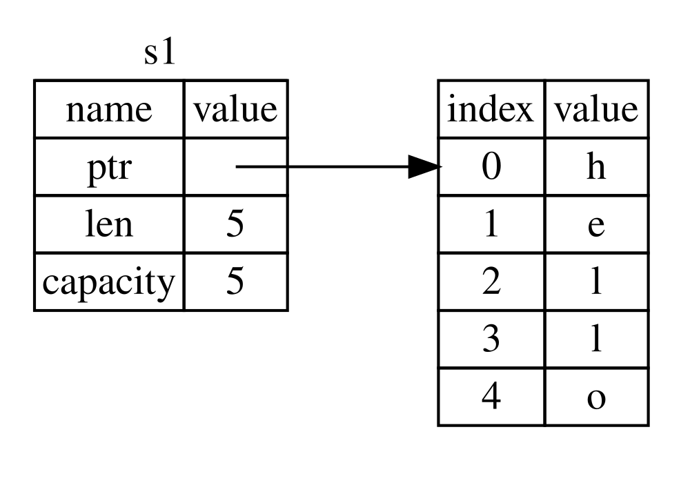
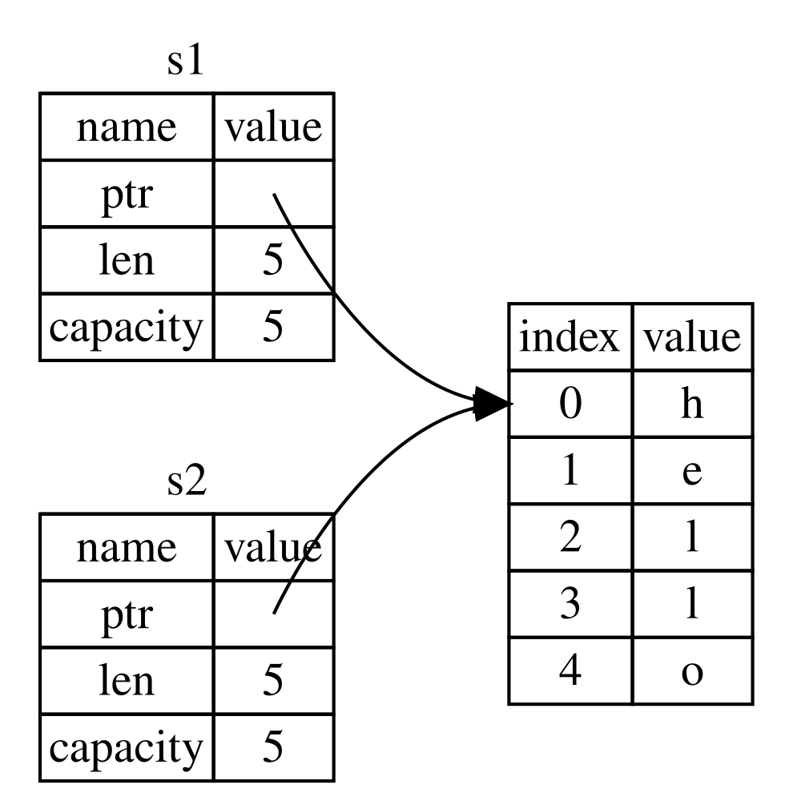
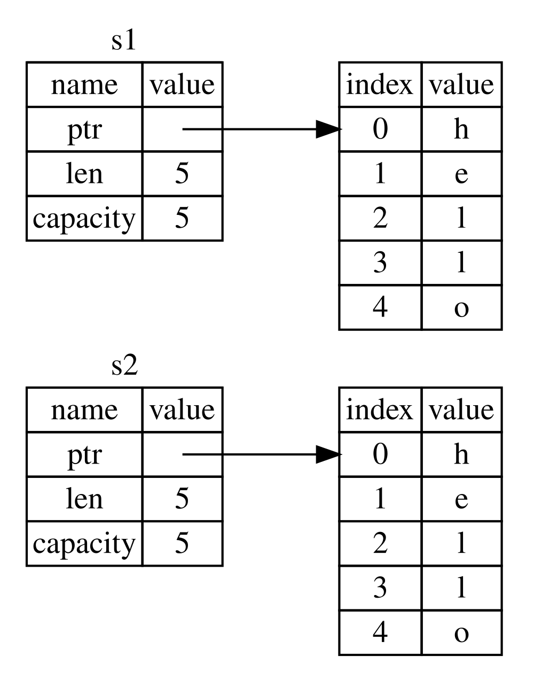
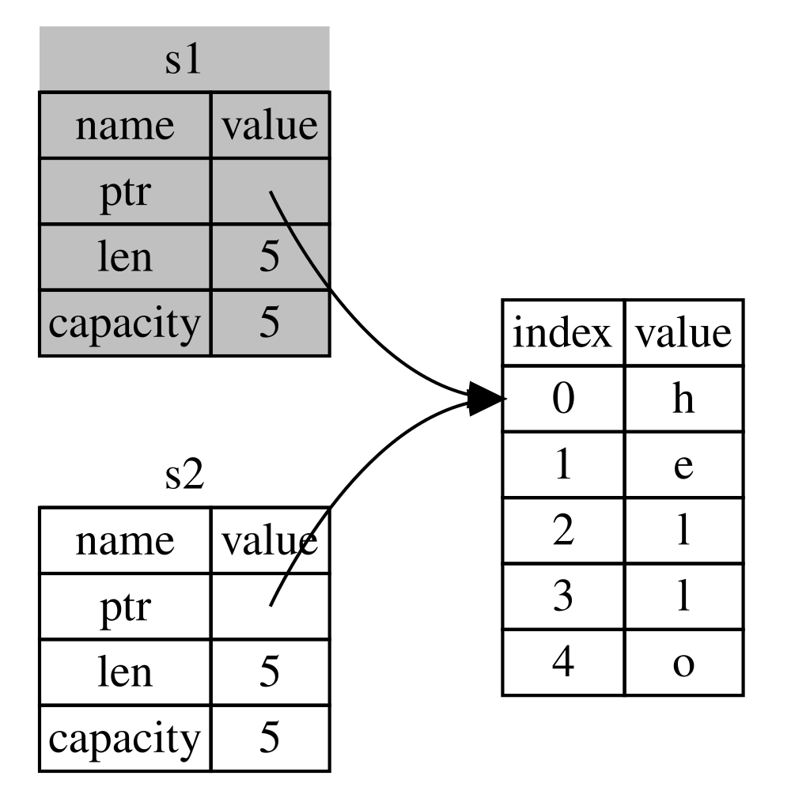
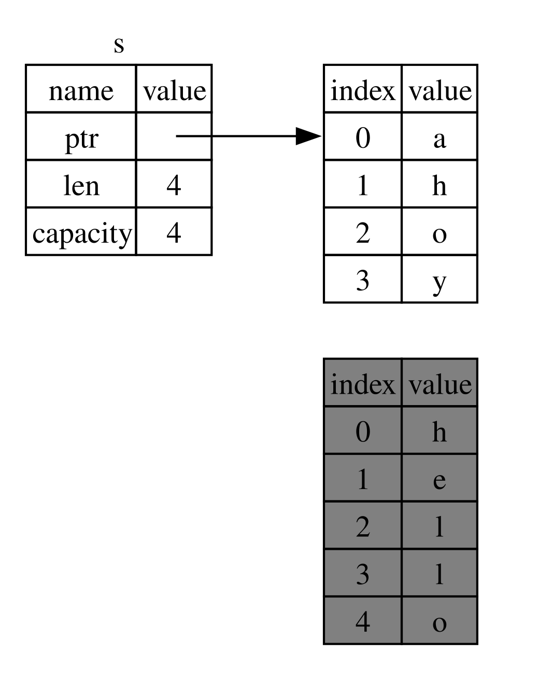

## Mi a tulajdonjog? {#what-is-ownership}

A _tulajdonjog (ownership)_ szabályok összessége, amelyek meghatározzák, hogyan
kezeli egy Rust-program a memóriát. Minden programnak gondoskodnia kell arról,
hogyan használja futás közben a számítógép memóriáját. Egyes nyelvekben van
szemétgyűjtés (garbage collection), amely a program futása közben rendszeresen
megkeresi a már nem használt memóriát; más nyelvekben a programozónak
kifejezetten le kell foglalnia és fel kell szabadítania a memóriát. A Rust egy
harmadik utat választ: a memóriát a tulajdonjog rendszere kezeli, egy olyan
szabálykészlet alapján, amelyet a fordító ellenőriz. Ha bármelyik szabály
sérül, a program nem fordul le. A tulajdonjog egyetlen eleme sem lassítja a
programodat futás közben.

Mivel a tulajdonjog sok programozó számára új fogalom, hozzászokni is időbe
telik. A jó hír az, hogy minél tapasztaltabb leszel a Rustban és a tulajdonjog
rendszerének szabályaiban, annál könnyebben írsz majd természetes módon
biztonságos és hatékony kódot. Csak így tovább!

Ha megérted a tulajdonjogot, szilárd alapod lesz azoknak a nyelvi elemeknek a
megértéséhez, amelyek a Rustot egyedivé teszik. Ebben a fejezetben néhány
példán keresztül ismerkedsz meg a tulajdonjoggal, amelyek egy nagyon gyakori
adatszerkezetre, a sztringekre összpontosítanak.

> ### A verem és a kupac {#the-stack-and-the-heap}
>
> Sok programozási nyelv nem követeli meg, hogy túl gyakran gondolj a veremre
> (stack) és a kupacra (heap). Egy olyan rendszerprogramozási nyelvben
> azonban, mint a Rust, az, hogy egy érték a veremben vagy a kupacon van,
> befolyásolja a nyelv viselkedését, és azt is, miért kell bizonyos döntéseket
> meghoznod. A fejezet későbbi részében a tulajdonjog egyes elemeit a veremhez
> és a kupachoz kapcsolódóan írjuk le, ezért előkészítésként itt egy rövid
> magyarázat.
>
> A verem és a kupac is a memória olyan része, amelyet a kódod futásidőben
> használhat, de eltérő a felépítésük. A verem az értékeket abban a sorrendben
> tárolja, ahogyan megkapja őket, és fordított sorrendben távolítja el őket.
> Ezt _utolsóként be, elsőként ki (last in, first out, LIFO)_ elvnek nevezzük.
> Gondolj egy tányérhalomra: ha újabb tányérokat teszel rá, a halom tetejére
> rakod őket, és ha szükséged van egy tányérra, a tetejéről veszel le egyet. A
> tányérok középről vagy alulról való hozzáadása vagy elvétele nem működne
> ilyen jól! Az adatok hozzáadását _verembe helyezésnek (pushing onto the
> stack)_, az eltávolításukat pedig _veremből kivételnek (popping off the
> stack)_ nevezzük. A veremben tárolt összes adatnak ismert, rögzített méretűnek
> kell lennie. Azokat az adatokat, amelyeknek a mérete fordítási időben
> ismeretlen, vagy a méretük változhat, ehelyett a kupacon kell tárolni.
>
> A kupac kevésbé rendezett: amikor adatot teszel a kupacra, egy bizonyos
> mennyiségű helyet kérsz. A memóriafoglaló (memory allocator) talál a kupacon
> egy elég nagy üres helyet, megjelöli foglaltként, és visszaad egy _mutatót
> (pointer)_, amely ennek a helynek a címe. Ezt a folyamatot _kupacon való
> foglalásnak (allocating on the heap)_, néha röviden csak _foglalásnak
> (allocating)_ nevezzük (az értékek verembe helyezése nem számít
> foglalásnak). Mivel a kupacra mutató mutató ismert, rögzített méretű, a
> mutatót tárolhatod a veremben, de ha a tényleges adatra van szükséged,
> követned kell a mutatót. Gondolj arra, amikor egy étteremben leültetnek.
> Belépéskor megmondod, hányan vagytok, a pincér pedig keres egy üres
> asztalt, ahol mindenki elfér, és odavezet. Ha valaki a társaságból késik,
> megkérdezheti, hová ültettek titeket, hogy megtaláljon.
>
> A verembe helyezés gyorsabb, mint a kupacon való foglalás, mert a
> memóriafoglalónak sosem kell helyet keresnie az új adat tárolásához: az a
> hely mindig a verem tetején van. Ehhez képest a kupacon való helyfoglalás
> több munkával jár, mert a memóriafoglalónak előbb egy elég nagy helyet kell
> találnia az adat tárolására, majd nyilvántartást kell vezetnie, hogy
> felkészüljön a következő foglalásra.
>
> A kupacon lévő adatok elérése általában lassabb, mint a veremben lévőké, mert
> egy mutatót kell követned, hogy odajuss. A mai processzorok gyorsabbak, ha
> kevesebbet ugrálnak a memóriában. Az éttermes hasonlatot folytatva gondolj
> egy pincérre, aki sok asztaltól veszi fel a rendeléseket. Az a
> leghatékonyabb, ha egy asztalnál az összes rendelést felveszi, mielőtt a
> következő asztalhoz lépne. Ha az A asztaltól venne fel egy rendelést, aztán a
> B asztaltól, majd megint az A-tól, aztán megint a B-től, az sokkal lassabb
> folyamat lenne. Ugyanígy a processzor is általában jobban végzi a dolgát, ha
> olyan adatokon dolgozik, amelyek közel vannak más adatokhoz (ahogy a
> veremben), és nem távolabb (ahogy a kupacon lehetnek).
>
> Amikor a kódod meghív egy függvényt, a függvénynek átadott értékek
> (beleértve akár a kupacon lévő adatokra mutató mutatókat is) és a függvény
> lokális változói a verembe kerülnek. Amikor a függvény véget ér, ezek az
> értékek kikerülnek a veremből.
>
> Annak nyilvántartása, hogy a kód mely részei a kupac mely adatait használják,
> a kupacon lévő ismétlődő adatok mennyiségének minimalizálása, valamint a
> kupacon lévő, már nem használt adatok eltakarítása, hogy ne fogyj ki a
> helyből – ezek mind olyan problémák, amelyeket a tulajdonjog kezel. Ha
> megérted a tulajdonjogot, nem kell majd túl gyakran a veremre és a kupacra
> gondolnod. Ha azonban tudod, hogy a tulajdonjog fő célja a kupacon lévő
> adatok kezelése, az segít megérteni, miért működik úgy, ahogy.

### A tulajdonjog szabályai {#ownership-rules}

Először nézzük meg a tulajdonjog szabályait. Tartsd észben ezeket a
szabályokat, miközben végigmegyünk az őket szemléltető példákon:

- A Rustban minden értéknek van egy _tulajdonosa (owner)_.
- Egyszerre csak egy tulajdonos lehet.
- Amikor a tulajdonos kikerül a hatókörből, az érték eldobásra kerül (drop).

### A változók hatóköre {#variable-scope}

Mivel túl vagyunk a Rust alapvető szintaxisán, a példákban már nem írjuk ki a
teljes `fn main() {` kódot, így ha követed a példákat, a következőket kézzel
tedd egy `main` függvénybe. Ennek eredményeként a példáink kicsit tömörebbek
lesznek, és a sablonkód helyett a lényeges részletekre összpontosíthatunk.

A tulajdonjog első példájaként néhány változó _hatókörét (scope)_ nézzük meg.
A hatókör a programnak az a tartománya, amelyen belül egy elem érvényes. Vegyük
a következő változót:

```rust
let s = "hello";
```

Az `s` változó egy sztringliterálra hivatkozik, ahol a sztring értéke bele van
égetve a programunk szövegébe. A változó a deklarálásától az aktuális hatókör
végéig érvényes. A 4-1. kódrészlet egy olyan programot mutat, amelyben
kommentek jelzik, hol érvényes az `s` változó.

<Listing number="4-1" caption="Egy változó és a hatókör, amelyben érvényes">

```rust
{{#rustdoc_include ../listings/ch04-understanding-ownership/listing-04-01/src/main.rs:here}}
```

</Listing>

Más szóval itt két fontos időpont van:

- Amikor az `s` hatókörbe _kerül_, érvényes.
- Addig marad érvényes, amíg ki nem _kerül_ a hatókörből.

Ezen a ponton a hatókörök és a változók érvényessége közötti kapcsolat hasonló
ahhoz, ami más programozási nyelvekben megszokott. Most erre a tudásra építünk,
és bemutatjuk a `String` típust.

### A `String` típus {#the-string-type}

A tulajdonjog szabályainak szemléltetéséhez egy összetettebb adattípusra van
szükségünk, mint amilyeneket a 3. fejezet [„Adattípusok”][data-types]<!--
ignore --> szakaszában tárgyaltunk. A korábban bemutatott típusok ismert
méretűek, tárolhatók a veremben, és kivehetők onnan, amikor a hatókörük véget
ér, továbbá gyorsan és egyszerűen lemásolhatók egy új, független példánnyá, ha
a kód egy másik részének ugyanarra az értékre van szüksége egy másik
hatókörben. Mi azonban olyan adatokat szeretnénk megvizsgálni, amelyek a
kupacon tárolódnak, és azt, honnan tudja a Rust, mikor kell eltakarítania
ezeket az adatokat. Erre a `String` típus kiváló példa.

A `String` azon részeire összpontosítunk, amelyek a tulajdonjoghoz
kapcsolódnak. Ezek a szempontok más összetett adattípusokra is érvényesek,
akár a standard könyvtár biztosítja őket, akár te hozod létre őket. A `String`
tulajdonjoghoz nem kapcsolódó jellemzőiről a [8. fejezetben][ch8]<!-- ignore
--> lesz szó.

Láttunk már sztringliterálokat, amelyekben a sztring értéke bele van égetve a
programunkba. A sztringliterálok kényelmesek, de nem minden olyan helyzetre
alkalmasak, amikor szöveget szeretnénk használni. Az egyik ok az, hogy nem
módosíthatók (immutable). A másik, hogy nem minden sztring értéke ismert,
amikor a kódot írjuk: mi van például, ha a felhasználótól szeretnénk bemenetet
kérni és azt eltárolni? Ezekre a helyzetekre szolgál a Rustban a `String`
típus. Ez a típus a kupacon lefoglalt adatokat kezel, így olyan mennyiségű
szöveget is képes tárolni, amely fordítási időben ismeretlen számunkra. Egy
`String`-et sztringliterálból a `from` függvénnyel hozhatsz létre, így:

```rust
let s = String::from("hello");
```

A kettős kettőspont (`::`) operátor lehetővé teszi, hogy ezt a konkrét `from`
függvényt a `String` típus névterébe helyezzük, ahelyett hogy valamilyen
`string_from`-szerű nevet használnánk. Erről a szintaxisról bővebben az 5.
fejezet [„Metódusok”][methods]<!-- ignore --> szakaszában lesz szó, valamint a
7. fejezetben, amikor a modulokkal való névtérkezelésről beszélünk az [„Elemekre
hivatkozó útvonalak a modulfában”][paths-module-tree]<!-- ignore -->
szakaszban.

Ez a fajta sztring _módosítható_:

```rust
{{#rustdoc_include ../listings/ch04-understanding-ownership/no-listing-01-can-mutate-string/src/main.rs:here}}
```

Mi tehát a különbség? Miért módosítható a `String`, a literálok pedig miért
nem? A különbség abban rejlik, hogyan kezeli ez a két típus a memóriát.

### Memória és foglalás {#memory-and-allocation}

Egy sztringliterál esetében a tartalmat fordítási időben ismerjük, így a
szöveg közvetlenül bele van égetve a végső futtatható állományba. Ezért gyorsak
és hatékonyak a sztringliterálok. Ezek a tulajdonságok azonban csak abból
fakadnak, hogy a sztringliterál nem módosítható. Sajnos nem tehetünk a
binárisba egy-egy memóriadarabot minden olyan szöveghez, amelynek a mérete
fordítási időben ismeretlen, és a program futása közben változhat.

A `String` típus esetében ahhoz, hogy egy módosítható (mutable), bővíthető
szövegdarabot támogassunk, a tartalom tárolására a kupacon kell lefoglalnunk
egy fordítási időben ismeretlen mennyiségű memóriát. Ez a következőket
jelenti:

- A memóriát futásidőben kell kérni a memóriafoglalótól.
- Szükségünk van egy módszerre, amellyel visszaadhatjuk ezt a memóriát a
  memóriafoglalónak, amikor végeztünk a `String`-gel.

Az első részt mi magunk végezzük el: amikor meghívjuk a `String::from`-ot, az
implementációja lefoglalja a szükséges memóriát. Ez szinte minden programozási
nyelvben így van.

A második rész azonban eltér. Azokban a nyelvekben, amelyekben van
_szemétgyűjtő (garbage collector, GC)_, a GC nyomon követi és eltakarítja a
már nem használt memóriát, nekünk pedig nem kell vele foglalkoznunk. A legtöbb
GC nélküli nyelvben a mi felelősségünk felismerni, mikor nincs már használatban
a memória, és meghívni a kódot, amely kifejezetten felszabadítja, ugyanúgy,
ahogy a lefoglalásakor is tettük. Ennek helyes elvégzése történelmileg nehéz
programozási problémának bizonyult. Ha elfelejtjük, memóriát pazarolunk. Ha túl
korán tesszük meg, érvénytelen változónk lesz. Ha kétszer tesszük meg, az is
hiba. Pontosan egy `allocate`-et pontosan egy `free`-vel kell párosítanunk.

A Rust más utat követ: a memória automatikusan visszakerül, amint a
tulajdonosaként szolgáló változó kikerül a hatókörből. Íme a 4-1. kódrészlet
hatókör-példájának egy változata, amely sztringliterál helyett `String`-et
használ:

```rust
{{#rustdoc_include ../listings/ch04-understanding-ownership/no-listing-02-string-scope/src/main.rs:here}}
```

Van egy természetes pont, amikor a `String` által igényelt memóriát
visszaadhatjuk a memóriafoglalónak: amikor az `s` kikerül a hatókörből. Amikor
egy változó kikerül a hatókörből, a Rust meghív helyettünk egy különleges
függvényt. Ennek a függvénynek a neve `drop`, és ide helyezheti el a `String`
szerzője a memória visszaadásáért felelős kódot. A Rust a záró kapcsos
zárójelnél automatikusan meghívja a `drop`-ot.

> Megjegyzés: A C++-ban az erőforrások egy elem élettartamának végén történő
> felszabadításának ezt a mintáját néha _Resource Acquisition Is
> Initialization (RAII)_ néven emlegetik. A Rust `drop` függvénye ismerős lesz,
> ha használtál már RAII-mintákat.

Ez a minta mélyrehatóan befolyásolja, hogyan írunk Rust-kódot. Most még
egyszerűnek tűnhet, de összetettebb helyzetekben, amikor több változóval
szeretnénk használni a kupacon lefoglalt adatokat, a kód viselkedése
váratlan lehet. Vizsgáljunk meg most néhány ilyen helyzetet.

<!-- Old headings. Do not remove or links may break. -->

<a id="ways-variables-and-data-interact-move"></a>

#### Változók és adatok kölcsönhatása mozgatással {#variables-and-data-interacting-with-move}

A Rustban több változó is többféleképpen kapcsolódhat ugyanahhoz az adathoz.
A 4-2. kódrészlet egy egész számot használó példát mutat.

<Listing number="4-2" caption="Az `x` változó egész értékének hozzárendelése az `y`-hoz">

```rust
{{#rustdoc_include ../listings/ch04-understanding-ownership/listing-04-02/src/main.rs:here}}
```

</Listing>

Valószínűleg kitaláljuk, mit csinál ez a kód: „Kösd az `5` értéket az `x`-hez;
aztán készíts másolatot az `x`-ben lévő értékről, és kösd az `y`-hoz.” Most két
változónk van, az `x` és az `y`, és mindkettő értéke `5`. Valóban ez történik,
mert az egész számok ismert, rögzített méretű egyszerű értékek, és ez a két
`5` érték a verembe kerül.

Most nézzük meg a `String`-es változatot:

```rust
{{#rustdoc_include ../listings/ch04-understanding-ownership/no-listing-03-string-move/src/main.rs:here}}
```

Ez nagyon hasonlónak tűnik, így feltételezhetnénk, hogy ugyanúgy is működik:
vagyis a második sor másolatot készít az `s1`-ben lévő értékről, és az `s2`-höz
köti. De nem egészen ez történik.

Nézd meg a 4-1. ábrát, hogy lásd, mi történik a `String`-gel a háttérben. Egy
`String` három részből áll, ezek balra láthatók: egy mutatóból, amely a sztring
tartalmát tároló memóriára mutat, egy hosszból és egy kapacitásból. Ez az
adatcsoport a veremben tárolódik. Jobbra a kupacon lévő memória látható, amely
a tartalmat tárolja.



<span class="caption">4-1. ábra: Az `s1`-hez kötött, `"hello"` értéket tároló
`String` ábrázolása a memóriában</span>

A hossz azt mutatja, hogy a `String` tartalma jelenleg hány bájtnyi memóriát
használ. A kapacitás az a teljes memóriamennyiség bájtban, amelyet a `String` a
memóriafoglalótól kapott. A hossz és a kapacitás közötti különbség fontos, de
ebben az összefüggésben nem, így egyelőre nyugodtan figyelmen kívül hagyhatod
a kapacitást.

Amikor az `s1`-et hozzárendeljük az `s2`-höz, a `String` adatai lemásolódnak,
vagyis a veremben lévő mutatót, hosszt és kapacitást másoljuk le. A kupacon
lévő adatokat, amelyekre a mutató hivatkozik, nem másoljuk le. Más szóval az
adatok memóriabeli ábrázolása a 4-2. ábrán láthatóhoz hasonló.



<span class="caption">4-2. ábra: Az `s2` változó ábrázolása a memóriában,
amely az `s1` mutatójának, hosszának és kapacitásának másolatát tárolja</span>

Az ábrázolás _nem_ a 4-3. ábrához hasonló, amely azt mutatja, hogyan nézne ki
a memória, ha a Rust a kupacon lévő adatokat is lemásolná. Ha a Rust ezt
tenné, az `s2 = s1` művelet futásidejű teljesítmény szempontjából nagyon
költséges lehetne, ha a kupacon lévő adat nagy.



<span class="caption">4-3. ábra: Egy másik lehetőség arra, mit tehetne az
`s2 = s1`, ha a Rust a kupacon lévő adatokat is lemásolná</span>

Korábban azt mondtuk, hogy amikor egy változó kikerül a hatókörből, a Rust
automatikusan meghívja a `drop` függvényt, és eltakarítja az adott változóhoz
tartozó kupacmemóriát. A 4-2. ábrán azonban mindkét adatmutató ugyanarra a
helyre mutat. Ez probléma: amikor az `s2` és az `s1` kikerül a hatókörből,
mindkettő ugyanazt a memóriát próbálja majd felszabadítani. Ezt _kétszeres
felszabadítási (double free)_ hibának nevezzük, és ez az egyik korábban
említett memóriabiztonsági hiba. A memória kétszeri felszabadítása
memóriasérüléshez vezethet, ami akár biztonsági résekhez is vezethet.

A memóriabiztonság érdekében a `let s2 = s1;` sor után a Rust az `s1`-et már
nem tekinti érvényesnek. Ezért a Rustnak semmit sem kell felszabadítania,
amikor az `s1` kikerül a hatókörből. Nézd meg, mi történik, ha az `s2`
létrehozása után megpróbálod használni az `s1`-et; nem fog működni:

```rust,ignore,does_not_compile
{{#rustdoc_include ../listings/ch04-understanding-ownership/no-listing-04-cant-use-after-move/src/main.rs:here}}
```

Egy ehhez hasonló hibát kapsz, mert a Rust megakadályozza, hogy az
érvénytelenített referenciát használd:

```console
{{#include ../listings/ch04-understanding-ownership/no-listing-04-cant-use-after-move/output.txt}}
```

Ha más nyelvekkel dolgozva hallottál már a _sekély másolás (shallow copy)_ és
a _mély másolás (deep copy)_ kifejezésekről, akkor a mutató, a hossz és a
kapacitás lemásolása az adatok másolása nélkül valószínűleg sekély másolásnak
tűnik. Mivel azonban a Rust az első változót is érvényteleníti, ezt nem sekély
másolásnak, hanem _mozgatásnak (move)_ nevezzük. Ebben a példában azt mondanánk,
hogy az `s1`-et _átmozgattuk_ az `s2`-be. Ami tehát valójában történik, azt a
4-4. ábra mutatja.



<span class="caption">4-4. ábra: Az ábrázolás a memóriában, miután az `s1`
érvénytelenné vált</span>

Ez megoldja a problémánkat! Mivel csak az `s2` érvényes, amikor kikerül a
hatókörből, egyedül ő szabadítja fel a memóriát, és kész is vagyunk.

Ebből ráadásul egy tervezési döntés is következik: a Rust soha nem készít
automatikusan „mély” másolatot az adataidról. Így bármilyen _automatikus_
másolásról feltételezhető, hogy futásidejű teljesítmény szempontjából olcsó.

#### Hatókör és értékadás {#scope-and-assignment}

Ennek a fordítottja is igaz a hatókörök, a tulajdonjog és a `drop` függvénnyel
történő memória-felszabadítás kapcsolatára. Amikor egy már létező változónak
egy teljesen új értéket adsz, a Rust meghívja a `drop`-ot, és azonnal
felszabadítja az eredeti érték memóriáját. Vegyük például ezt a kódot:

```rust
{{#rustdoc_include ../listings/ch04-understanding-ownership/no-listing-04b-replacement-drop/src/main.rs:here}}
```

Először deklarálunk egy `s` változót, és egy `"hello"` értékű `String`-hez
kötjük. Ezután rögtön létrehozunk egy új, `"ahoy"` értékű `String`-et, és az
`s`-hez rendeljük. Ezen a ponton már semmi sem hivatkozik a kupacon lévő
eredeti értékre. A 4-5. ábra a verem és a kupac adatait mutatja ebben az
állapotban:



<span class="caption">4-5. ábra: Az ábrázolás a memóriában, miután a kezdeti
értéket teljes egészében lecseréltük</span>

Az eredeti sztring így azonnal kikerül a hatókörből. A Rust lefuttatja rajta a
`drop` függvényt, és a memóriája azonnal felszabadul. Amikor a végén kiírjuk az
értéket, az `"ahoy, world!"` lesz.

<!-- Old headings. Do not remove or links may break. -->

<a id="ways-variables-and-data-interact-clone"></a>

#### Változók és adatok kölcsönhatása klónozással {#variables-and-data-interacting-with-clone}

Ha a `String` kupacon lévő adatairól _valóban_ mély másolatot szeretnénk
készíteni, nem csak a veremben lévő adatokról, használhatunk egy gyakori
metódust, a `clone`-t. A metódusszintaxisról az 5. fejezetben lesz szó, de
mivel a metódusok sok programozási nyelvben megtalálhatók, valószínűleg
találkoztál már velük.

Íme egy példa a `clone` metódus működésére:

```rust
{{#rustdoc_include ../listings/ch04-understanding-ownership/no-listing-05-clone/src/main.rs:here}}
```

Ez remekül működik, és kifejezetten a 4-3. ábrán látható viselkedést
eredményezi, ahol a kupacon lévő adatok _valóban_ lemásolódnak.

Amikor egy `clone`-hívást látsz, tudhatod, hogy valamilyen tetszőleges kód fut
le, és ez a kód költséges lehet. Ez egy vizuális jelzés arra, hogy valami más
történik.

#### Csak veremben tárolt adatok: Copy {#stack-only-data-copy}

Van még egy csavar, amelyről eddig nem beszéltünk. Ez az egész számokat
használó kód – amelynek egy részét a 4-2. kódrészlet mutatta – működik, és
érvényes:

```rust
{{#rustdoc_include ../listings/ch04-understanding-ownership/no-listing-06-copy/src/main.rs:here}}
```

Ez a kód azonban látszólag ellentmond annak, amit az imént tanultunk: nincs
`clone`-hívásunk, az `x` mégis érvényes marad, és nem mozgattuk át az `y`-ba.

Ennek az az oka, hogy az olyan típusok, mint az egész számok, amelyeknek a
mérete fordítási időben ismert, teljes egészében a veremben tárolódnak, így a
tényleges értékekről gyorsan készíthető másolat. Ez azt jelenti, hogy semmi
okunk megakadályozni, hogy az `x` érvényes maradjon az `y` változó létrehozása
után. Más szóval itt nincs különbség a mély és a sekély másolás között, így a
`clone` meghívása semmi mást nem tenne, mint a szokásos sekély másolás, ezért
el is hagyhatjuk.

A Rustnak van egy különleges annotációja, a `Copy` trait, amelyet olyan
típusokra tehetünk, amelyek a veremben tárolódnak, ahogy az egész számok is (a
traitekről bővebben a [10. fejezetben][traits]<!-- ignore --> lesz szó). Ha egy
típus megvalósítja a `Copy` traitet, az azt használó változók nem mozognak,
hanem egyszerűen lemásolódnak, így egy másik változónak való értékadás után is
érvényesek maradnak.

A Rust nem engedi, hogy egy típust a `Copy`-val annotáljunk, ha maga a típus
vagy bármelyik része megvalósította a `Drop` traitet. Ha a típusnak valami
különlegesre van szüksége, amikor az érték kikerül a hatókörből, és a `Copy`
annotációt adjuk a típushoz, fordítási idejű hibát kapunk. Arról, hogyan adhatod
hozzá a `Copy` annotációt a típusodhoz a trait megvalósításához, a C. függelék
[„Származtatható traitek”][derivable-traits]<!-- ignore --> szakaszában
olvashatsz.

Mely típusok megvalósítják tehát a `Copy` traitet? Az adott típus
dokumentációjában ellenőrizheted, de általános szabályként bármilyen egyszerű
skaláris értékekből álló csoport megvalósíthatja a `Copy`-t, és semmi, ami
foglalást igényel, vagy valamilyen erőforrás, nem megvalósíthatja a `Copy`-t.
Íme néhány típus, amely megvalósítja a `Copy`-t:

- Az összes egész típus, például az `u32`.
- A logikai típus, a `bool`, a `true` és a `false` értékekkel.
- Az összes lebegőpontos típus, például az `f64`.
- A karaktertípus, a `char`.
- A tuple-ök, ha csak olyan típusokat tartalmaznak, amelyek szintén
  megvalósítják a `Copy`-t. Például az `(i32, i32)` megvalósítja a `Copy`-t,
  az `(i32, String)` viszont nem.

### Tulajdonjog és függvények {#ownership-and-functions}

Egy érték függvénynek való átadásának mechanizmusa hasonló ahhoz, amikor egy
változónak értéket adunk. Ha egy változót átadunk egy függvénynek, az ugyanúgy
mozgatással vagy másolással jár, mint az értékadás. A 4-3. kódrészlet egy
példát mutat néhány megjegyzéssel, amelyek jelzik, hol kerülnek a változók
hatókörbe, és hol kerülnek ki onnan.

<Listing number="4-3" file-name="src/main.rs" caption="Függvények a tulajdonjogot és a hatókört jelölő megjegyzésekkel">

```rust
{{#rustdoc_include ../listings/ch04-understanding-ownership/listing-04-03/src/main.rs}}
```

</Listing>

Ha a `takes_ownership` hívása után megpróbálnánk használni az `s`-t, a Rust
fordítási idejű hibát jelezne. Ezek a statikus ellenőrzések megvédenek minket a
hibáktól. Próbálj meg olyan kódot írni a `main`-be, amely az `s`-t és az `x`-et
használja, hogy lásd, hol használhatod őket, és hol akadályoznak meg ebben a
tulajdonjog szabályai.

### Visszatérési értékek és hatókör {#return-values-and-scope}

Az értékek visszaadása is átruházhatja a tulajdonjogot. A 4-4. kódrészlet egy
olyan függvényre mutat példát, amely valamilyen értéket ad vissza, a 4-3.
kódrészletben láthatókhoz hasonló megjegyzésekkel.

<Listing number="4-4" file-name="src/main.rs" caption="A visszatérési értékek tulajdonjogának átruházása">

```rust
{{#rustdoc_include ../listings/ch04-understanding-ownership/listing-04-04/src/main.rs}}
```

</Listing>

Egy változó tulajdonjoga minden alkalommal ugyanazt a mintát követi: ha egy
értéket egy másik változóhoz rendelünk, az mozgatással jár. Amikor egy
kupacon lévő adatokat tartalmazó változó kikerül a hatókörből, az értéket a
`drop` eltakarítja, hacsak az adatok tulajdonjogát át nem mozgattuk egy másik
változóba.

Bár ez működik, a tulajdonjog átvétele, majd visszaadása minden egyes
függvénynél kissé fárasztó. Mi van, ha azt szeretnénk, hogy egy függvény
használhasson egy értéket, de ne vegye át a tulajdonjogát? Elég bosszantó, hogy
mindent, amit átadunk, vissza is kell kapnunk, ha újra használni szeretnénk,
ráadásul a függvénytörzsből származó, esetleg szintén visszaadandó adatokon
felül.

A Rust lehetővé teszi, hogy egy tuple segítségével több értéket adjunk vissza,
ahogy a 4-5. kódrészlet mutatja.

<Listing number="4-5" file-name="src/main.rs" caption="A paraméterek tulajdonjogának visszaadása">

```rust
{{#rustdoc_include ../listings/ch04-understanding-ownership/listing-04-05/src/main.rs}}
```

</Listing>

Ez azonban túl sok szertartás és túl sok munka egy olyan fogalomhoz, amelynek
mindennaposnak kellene lennie. Szerencsére a Rustnak van egy nyelvi eleme,
amellyel egy értéket a tulajdonjog átruházása nélkül használhatunk: a
referenciák.

[data-types]: ch03-02-data-types.html#data-types
[ch8]: ch08-02-strings.html
[traits]: ch10-02-traits.html
[derivable-traits]: appendix-03-derivable-traits.html
[methods]: ch05-03-method-syntax.html#methods
[paths-module-tree]: ch07-03-paths-for-referring-to-an-item-in-the-module-tree.html
