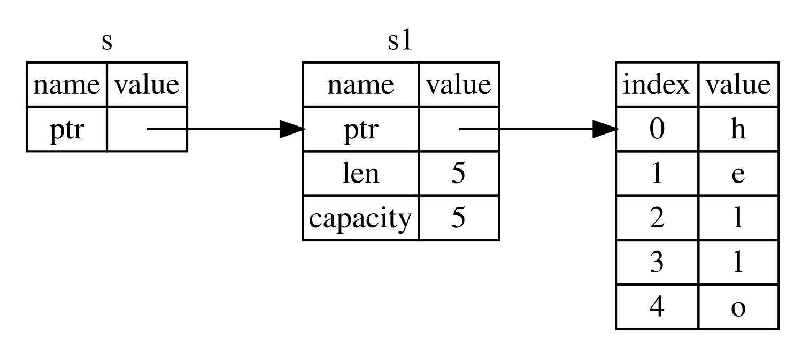

## Referenciák és kölcsönzés {#references-and-borrowing}

A 4-5. kódrészlet tuple-ös kódjával az a gond, hogy vissza kell adnunk a
`String`-et a hívó függvénynek, hogy a `calculate_length` hívása után is
használhassuk, mert a `String` át lett mozgatva a `calculate_length`-be.
Ehelyett átadhatunk egy referenciát a `String` értékre. A _referencia
(reference)_ annyiban hasonlít egy mutatóra, hogy egy cím, amelyet követve
elérhetjük az ott tárolt adatot; ennek az adatnak egy másik változó a
tulajdonosa. A mutatóval ellentétben a referencia garantáltan egy adott típus
érvényes értékére mutat a referencia teljes élettartama alatt.

Így definiálhatsz és használhatsz egy olyan `calculate_length` függvényt,
amelynek paramétere egy objektumra mutató referencia, ahelyett hogy átvenné az
érték tulajdonjogát (ownership):

<Listing file-name="src/main.rs">

```rust
{{#rustdoc_include ../listings/ch04-understanding-ownership/no-listing-07-reference/src/main.rs:all}}
```

</Listing>

Először is figyeld meg, hogy a változódeklarációból és a függvény visszatérési
értékéből eltűnt a tuple-ös kód. Másodszor vedd észre, hogy a
`calculate_length`-nek az `&s1`-et adjuk át, a definíciójában pedig `String`
helyett `&String`-et fogadunk. Ezek az „és” jelek (`&`) referenciákat jelölnek,
és lehetővé teszik, hogy egy értékre hivatkozz anélkül, hogy átvennéd a
tulajdonjogát. A 4-6. ábra ezt a fogalmat szemlélteti.



<span class="caption">4-6. ábra: Az `s1` `String`-re mutató `&String` típusú
`s` ábrája</span>

> Megjegyzés: Az `&` segítségével történő hivatkozás ellentéte a
> _dereferálás (dereferencing)_, amelyet a dereferáló operátorral, a `*`-gal
> végzünk. A 8. fejezetben látunk majd néhány példát a dereferáló operátor
> használatára, a dereferálás részleteit pedig a 15. fejezetben tárgyaljuk.

Nézzük meg közelebbről a függvényhívást:

```rust
{{#rustdoc_include ../listings/ch04-understanding-ownership/no-listing-07-reference/src/main.rs:here}}
```

Az `&s1` szintaxissal létrehozhatunk egy referenciát, amely az `s1` értékére
_hivatkozik_, de nem tulajdonosa annak. Mivel a referencia nem tulajdonos, az
érték, amelyre mutat, nem kerül eldobásra (drop), amikor a referencia
használata véget ér.

Ugyanígy a függvény szignatúrája is az `&` jellel jelzi, hogy az `s` paraméter
típusa egy referencia. Lássuk el néhány magyarázó megjegyzéssel:

```rust
{{#rustdoc_include ../listings/ch04-understanding-ownership/no-listing-08-reference-with-annotations/src/main.rs:here}}
```

A hatókör (scope), amelyben az `s` változó érvényes, ugyanolyan, mint bármely
függvényparaméter hatóköre, de a referencia által mutatott érték nem kerül
eldobásra, amikor az `s` használata véget ér, mert az `s` nem rendelkezik
tulajdonjoggal. Ha a függvények paraméterként a tényleges értékek helyett
referenciákat kapnak, nem kell visszaadnunk az értékeket ahhoz, hogy
visszaadjuk a tulajdonjogot, mert soha nem is volt nálunk.

A referencia létrehozását _kölcsönzésnek (borrowing)_ nevezzük. Ahogy a való
életben is, ha valakinek van valamije, kölcsönkérheted tőle. Ha végeztél, vissza
kell adnod. Nem a tiéd.

Mi történik tehát, ha megpróbálunk módosítani valamit, amit kölcsönvettünk?
Próbáld ki a 4-6. kódrészlet kódját. Előre eláruljuk: nem működik!

<Listing number="4-6" file-name="src/main.rs" caption="Kísérlet egy kölcsönvett érték módosítására">

```rust,ignore,does_not_compile
{{#rustdoc_include ../listings/ch04-understanding-ownership/listing-04-06/src/main.rs}}
```

</Listing>

Ez a hibaüzenet:

```console
{{#include ../listings/ch04-understanding-ownership/listing-04-06/output.txt}}
```

Ahogy a változók alapértelmezés szerint nem módosíthatók (immutable), úgy a
referenciák sem. Nem módosíthatunk valamit, amire csak referenciánk van.

### Módosítható referenciák {#mutable-references}

A 4-6. kódrészlet kódját néhány apró változtatással kijavíthatjuk úgy, hogy
módosíthassunk egy kölcsönvett értéket, ha ehelyett egy _módosítható
referenciát (mutable reference)_ használunk:

<Listing file-name="src/main.rs">

```rust
{{#rustdoc_include ../listings/ch04-understanding-ownership/no-listing-09-fixes-listing-04-06/src/main.rs}}
```

</Listing>

Először is az `s`-t `mut`-tá alakítjuk. Ezután a `change` függvény hívásánál
az `&mut s` segítségével létrehozunk egy módosítható referenciát, a függvény
szignatúráját pedig úgy módosítjuk, hogy a `some_string: &mut String` révén
módosítható referenciát fogadjon. Ebből nagyon világos, hogy a `change`
függvény módosítani fogja a kölcsönvett értéket.

A módosítható referenciáknak van egy nagy megkötése: ha van egy módosítható
referenciád egy értékre, akkor arra az értékre nem lehet más referenciád. Ez a
kód, amely két módosítható referenciát próbál létrehozni az `s`-re, hibát fog
okozni:

<Listing file-name="src/main.rs">

```rust,ignore,does_not_compile
{{#rustdoc_include ../listings/ch04-understanding-ownership/no-listing-10-multiple-mut-not-allowed/src/main.rs:here}}
```

</Listing>

Ez a hibaüzenet:

```console
{{#include ../listings/ch04-understanding-ownership/no-listing-10-multiple-mut-not-allowed/output.txt}}
```

A hiba azt mondja, hogy a kód érvénytelen, mert az `s`-t egyszerre nem
kölcsönözhetjük módosíthatóként egynél többször. Az első módosítható
kölcsönzés az `r1`-ben van, és egészen a `println!`-ben való felhasználásáig
kell tartania, de a módosítható referencia létrehozása és felhasználása között
megpróbáltunk egy másik módosítható referenciát létrehozni az `r2`-ben, amely
ugyanazt az adatot kölcsönzi, mint az `r1`.

Az a megkötés, amely megakadályozza, hogy egyszerre több módosítható referencia
létezzen ugyanarra az adatra, lehetővé teszi a módosítást, de nagyon
ellenőrzött módon. Ezzel a kezdő rustaceanek gyakran küszködnek, mert a
legtöbb nyelv akkor enged módosítani, amikor csak szeretnéd. A megkötés előnye,
hogy a Rust már fordítási időben meg tudja akadályozni az adatversenyeket. Az
_adatverseny (data race)_ a versenyhelyzethez (race condition) hasonló, és
akkor lép fel, ha a következő három dolog teljesül:

- Két vagy több mutató egyszerre fér hozzá ugyanahhoz az adathoz.
- A mutatók közül legalább az egyiket az adat írására használják.
- Nincs semmilyen mechanizmus, amely szinkronizálná az adathoz való
  hozzáférést.

Az adatversenyek nem definiált viselkedést okoznak, és nehéz lehet
diagnosztizálni és kijavítani őket, amikor futásidőben próbálod felderíteni
őket; a Rust úgy előzi meg ezt a problémát, hogy egyszerűen nem hajlandó
lefordítani az adatversenyt tartalmazó kódot!

Mint mindig, kapcsos zárójelekkel új hatókört hozhatunk létre, így több
módosítható referenciát is használhatunk, csak nem _egyidejűleg_:

```rust
{{#rustdoc_include ../listings/ch04-understanding-ownership/no-listing-11-muts-in-separate-scopes/src/main.rs:here}}
```

A Rust hasonló szabályt érvényesít a módosítható és nem módosítható
referenciák együttes használatára. Ez a kód hibát eredményez:

```rust,ignore,does_not_compile
{{#rustdoc_include ../listings/ch04-understanding-ownership/no-listing-12-immutable-and-mutable-not-allowed/src/main.rs:here}}
```

Ez a hibaüzenet:

```console
{{#include ../listings/ch04-understanding-ownership/no-listing-12-immutable-and-mutable-not-allowed/output.txt}}
```

Hűha! Az sem lehetséges, hogy legyen egy módosítható referenciánk, miközben
egy nem módosítható is van ugyanarra az értékre.

Egy nem módosítható referencia használói nem számítanak arra, hogy az érték
hirtelen megváltozik a kezük alatt! Több nem módosítható referencia viszont
megengedett, mert aki csak olvassa az adatot, az nem tudja befolyásolni, hogy
mások mit olvasnak.

Vedd észre, hogy egy referencia hatóköre ott kezdődik, ahol létrehozzuk, és az
utolsó használatáig tart. Ez a kód például lefordul, mert a nem módosítható
referenciák utolsó használata a `println!`-ben van, még a módosítható referencia
létrehozása előtt:

```rust
{{#rustdoc_include ../listings/ch04-understanding-ownership/no-listing-13-reference-scope-ends/src/main.rs:here}}
```

Az `r1` és az `r2` nem módosítható referenciák hatóköre a `println!` után ér
véget, ahol utoljára használjuk őket, vagyis még az `r3` módosítható referencia
létrehozása előtt. Ezek a hatókörök nem fedik egymást, így ez a kód
megengedett: a fordító meg tudja állapítani, hogy a referenciát a hatókör vége
előtti ponton már nem használjuk.

Bár a kölcsönzési hibák időnként frusztrálóak lehetnek, ne feledd, hogy a Rust
fordító ezzel már korán (fordítási időben, nem pedig futásidőben) rámutat egy
lehetséges hibára, és pontosan megmutatja, hol van a probléma. Így nem kell
utánajárnod, miért nem az az adat, amire számítottál.

### Lógó referenciák {#dangling-references}

A mutatókat használó nyelvekben könnyű véletlenül _lógó mutatót (dangling
pointer)_ létrehozni – vagyis olyan mutatót, amely egy olyan memóriahelyre
hivatkozik, amelyet esetleg már valaki más kapott meg –, ha felszabadítunk
valamennyi memóriát, de megtartunk egy rá mutató mutatót. A Rustban ezzel
szemben a fordító garantálja, hogy a referenciák soha nem lesznek _lógó
referenciák (dangling references)_: ha van egy referenciád valamilyen adatra, a
fordító gondoskodik arról, hogy az adat ne kerüljön ki a hatókörből a rá
mutató referencia előtt.

Próbáljunk meg létrehozni egy lógó referenciát, hogy lássuk, hogyan előzi meg
a Rust fordítási idejű hibával:

<Listing file-name="src/main.rs">

```rust,ignore,does_not_compile
{{#rustdoc_include ../listings/ch04-understanding-ownership/no-listing-14-dangling-reference/src/main.rs}}
```

</Listing>

Ez a hibaüzenet:

```console
{{#include ../listings/ch04-understanding-ownership/no-listing-14-dangling-reference/output.txt}}
```

Ez a hibaüzenet egy olyan nyelvi elemre hivatkozik, amelyről még nem volt szó:
az élettartamokra. Az élettartamokat részletesen a 10. fejezetben tárgyaljuk.
Ha azonban figyelmen kívül hagyod az élettartamokról szóló részeket, az üzenet
tartalmazza a kulcsot ahhoz, miért problémás ez a kód:

```text
this function's return type contains a borrowed value, but there is no value
for it to be borrowed from
```

Nézzük meg közelebbről, mi történik pontosan a `dangle` kódunk egyes
szakaszaiban:

<Listing file-name="src/main.rs">

```rust,ignore,does_not_compile
{{#rustdoc_include ../listings/ch04-understanding-ownership/no-listing-15-dangling-reference-annotated/src/main.rs:here}}
```

</Listing>

Mivel az `s` a `dangle`-ön belül jön létre, amikor a `dangle` kódja véget ér,
az `s` felszabadul. Mi azonban megpróbáltunk visszaadni egy rá mutató
referenciát. Ez azt jelenti, hogy ez a referencia egy érvénytelen `String`-re
mutatna. Ez nem jó! A Rust ezt nem engedi meg.

A megoldás az, hogy közvetlenül a `String`-et adjuk vissza:

```rust
{{#rustdoc_include ../listings/ch04-understanding-ownership/no-listing-16-no-dangle/src/main.rs:here}}
```

Ez gond nélkül működik. A tulajdonjogot kimozgatjuk a függvényből, és semmi
sem szabadul fel.

### A referenciák szabályai {#the-rules-of-references}

Foglaljuk össze, mit tárgyaltunk a referenciákról:

- Egy adott pillanatban _vagy_ egy módosítható referenciád lehet, _vagy_
  tetszőleges számú nem módosítható referenciád.
- A referenciáknak mindig érvényesnek kell lenniük.

A következőkben egy másfajta referenciát nézünk meg: a szeleteket.
