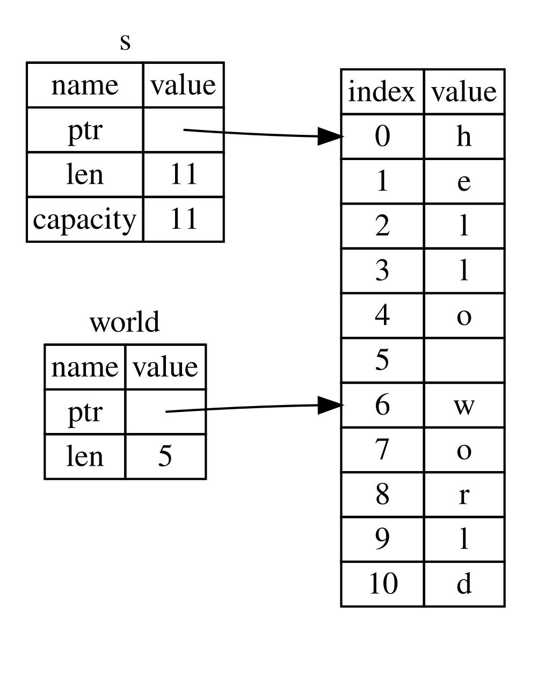

## A szelet típus {#the-slice-type}

A _szeletek (slices)_ segítségével egy
[gyűjtemény](ch08-00-common-collections.md)<!-- ignore --> elemeinek egy
összefüggő sorozatára hivatkozhatsz. A szelet egyfajta
referencia, így nem rendelkezik tulajdonjoggal (ownership).

Íme egy kis programozási feladat: írj egy függvényt, amely egy szóközökkel
elválasztott szavakból álló sztringet kap, és visszaadja az első szót, amelyet
abban a sztringben talál. Ha a függvény nem talál szóközt a sztringben, akkor
az egész sztring egyetlen szó, tehát a teljes sztringet kell visszaadnia.

> Megjegyzés: A szeletek bemutatása érdekében ebben a szakaszban csak ASCII
> karakterekkel számolunk; az UTF-8 kezelésének alaposabb tárgyalása a 8.
> fejezet
> [„UTF-8 kódolású szöveg tárolása sztringekkel”][strings]<!-- ignore -->
> szakaszában található.

Gondoljuk végig, hogyan írnánk meg ennek a függvénynek a szignatúráját szeletek
használata nélkül, hogy megértsük, milyen problémát oldanak meg a szeletek:

```rust,ignore
fn first_word(s: &String) -> ?
```

A `first_word` függvénynek egy `&String` típusú paramétere van. Nincs szükségünk
a tulajdonjogra, így ez rendben van. (Az idiomatikus Rustban a függvények nem
veszik át az argumentumaik tulajdonjogát, hacsak nincs rá szükségük; ennek okai
a továbbiakban világossá válnak.) De mit adjunk vissza? Nincs igazán módunk
arra, hogy egy sztring *egy részéről* beszéljünk. Visszaadhatjuk viszont a szó
végének indexét, amelyet egy szóköz jelez. Próbáljuk ki ezt, ahogy a 4-7.
kódrészlet mutatja.

<Listing number="4-7" file-name="src/main.rs" caption="A `first_word` függvény, amely egy, a `String` paraméterbe mutató bájtindexet ad vissza">

```rust
{{#rustdoc_include ../listings/ch04-understanding-ownership/listing-04-07/src/main.rs:here}}
```

</Listing>

Mivel elemről elemre végig kell mennünk a `String`-en, és meg kell néznünk,
hogy egy érték szóköz-e, a `String`-et az `as_bytes` metódussal bájtok tömbjévé
alakítjuk.

```rust,ignore
{{#rustdoc_include ../listings/ch04-understanding-ownership/listing-04-07/src/main.rs:as_bytes}}
```

Ezután az `iter` metódussal létrehozunk egy iterátort a bájttömb fölött:

```rust,ignore
{{#rustdoc_include ../listings/ch04-understanding-ownership/listing-04-07/src/main.rs:iter}}
```

Az iterátorokról részletesebben a [13. fejezetben][ch13]<!-- ignore --> lesz
szó. Egyelőre elég annyit tudnod, hogy az `iter` egy olyan metódus, amely egy
gyűjtemény minden elemét visszaadja, az `enumerate` pedig becsomagolja az
`iter` eredményét, és minden elemet egy tuple részeként ad vissza. Az
`enumerate` által visszaadott tuple első eleme az index, a második pedig egy
referencia az elemre. Ez egy kicsit kényelmesebb, mint ha magunk számolnánk az
indexet.

Mivel az `enumerate` metódus egy tuple-t ad vissza, mintákkal szétbonthatjuk
ezt a tuple-t. A mintákról bővebben a [6. fejezetben][ch6]<!-- ignore --> lesz
szó. A `for` ciklusban olyan mintát adunk meg, amelyben az `i` a tuple-ben lévő
index, az `&item` pedig a tuple-ben lévő egyetlen bájt. Mivel az
`.iter().enumerate()` egy referenciát ad az elemre, a mintában az `&` jelet
használjuk.

A `for` cikluson belül a bájtliterál-szintaxissal keressük a szóközt jelölő
bájtot. Ha találunk szóközt, visszaadjuk a pozícióját. Ellenkező esetben az
`s.len()` segítségével a sztring hosszát adjuk vissza.

```rust,ignore
{{#rustdoc_include ../listings/ch04-understanding-ownership/listing-04-07/src/main.rs:inside_for}}
```

Most már meg tudjuk állapítani a sztring első szava végének indexét, de van egy
probléma. Egy önálló `usize` értéket adunk vissza, amely azonban csak a
`&String` összefüggésében értelmes szám. Más szóval, mivel ez a `String`-től
különálló érték, semmi sem garantálja, hogy a jövőben is érvényes marad. Nézd
meg a 4-8. kódrészlet programját, amely a 4-7. kódrészlet `first_word`
függvényét használja.

<Listing number="4-8" file-name="src/main.rs" caption="A `first_word` függvény hívásának eredményét eltároljuk, majd megváltoztatjuk a `String` tartalmát">

```rust
{{#rustdoc_include ../listings/ch04-understanding-ownership/listing-04-08/src/main.rs:here}}
```

</Listing>

Ez a program hiba nélkül lefordul, és akkor is lefordulna, ha az `s.clear()`
hívása után használnánk a `word`-öt. Mivel a `word` egyáltalán nincs
összekapcsolva az `s` állapotával, a `word` továbbra is az `5` értéket
tartalmazza. Megpróbálhatnánk ezt az `5` értéket az `s` változóval együtt
használni az első szó kinyerésére, de ez hiba lenne, mert az `s` tartalma
megváltozott azóta, hogy az `5`-öt eltároltuk a `word`-ben.

Fárasztó és hibalehetőségekkel teli, ha azon kell aggódnunk, hogy a `word`-ben
lévő index elcsúszik az `s`-ben lévő adatokhoz képest! Ezeknek az indexeknek a
kezelése még törékenyebb, ha egy `second_word` függvényt írunk. Ennek a
szignatúrája így nézne ki:

```rust,ignore
fn second_word(s: &String) -> (usize, usize) {
```

Most már egy kezdő _és_ egy záró indexet is nyilvántartunk, és még több olyan
értékünk van, amelyet egy adott állapotban lévő adatokból számoltunk ki, de
egyáltalán nem kötődik ehhez az állapothoz. Három, egymással össze nem függő
változó lebeg körülöttünk, amelyeket szinkronban kell tartanunk.

Szerencsére a Rustnak van megoldása erre a problémára: a sztringszeletek.

### Sztringszeletek {#string-slices}

A _sztringszelet (string slice)_ egy `String` elemeinek egy összefüggő
sorozatára mutató referencia, és így néz ki:

```rust
{{#rustdoc_include ../listings/ch04-understanding-ownership/no-listing-17-slice/src/main.rs:here}}
```

A `hello` nem a teljes `String`-re mutató referencia, hanem a `String` egy
részére, amelyet a kiegészítő `[0..5]` rész határoz meg. Szeleteket szögletes
zárójelek közötti tartománnyal hozunk létre, a
`[starting_index..ending_index]` megadásával, ahol a _`starting_index`_ a
szelet első pozíciója, az _`ending_index`_ pedig eggyel több, mint a szelet
utolsó pozíciója. Belsőleg a szelet adatszerkezete a kezdőpozíciót és a szelet
hosszát tárolja, ami az _`ending_index`_ és a _`starting_index`_ különbsége.
Így a `let world = &s[6..11];` esetében a `world` egy olyan szelet lesz, amely
az `s` 6-os indexű bájtjára mutató mutatót és `5` hosszértéket tartalmaz.

A 4-7. ábra ezt egy diagramon mutatja be.



<span class="caption">4-7. ábra: Egy `String` egy részére hivatkozó
sztringszelet</span>

A Rust `..` tartományszintaxisával, ha a 0-s indextől szeretnél kezdeni,
elhagyhatod a két pont előtti értéket. Más szóval ezek egyenértékűek:

```rust
let s = String::from("hello");

let slice = &s[0..2];
let slice = &s[..2];
```

Ugyanígy, ha a szeleted a `String` utolsó bájtját is tartalmazza, elhagyhatod
a záró számot. Ez azt jelenti, hogy ezek egyenértékűek:

```rust
let s = String::from("hello");

let len = s.len();

let slice = &s[3..len];
let slice = &s[3..];
```

Mindkét értéket el is hagyhatod, így a teljes sztringből készítesz szeletet.
Ezek tehát egyenértékűek:

```rust
let s = String::from("hello");

let len = s.len();

let slice = &s[0..len];
let slice = &s[..];
```

> Megjegyzés: A sztringszeletek tartományindexeinek érvényes UTF-8
> karakterhatárokra kell esniük. Ha egy többbájtos karakter közepén próbálsz
> sztringszeletet létrehozni, a programod hibával kilép.

Mindezt szem előtt tartva írjuk át a `first_word`-öt úgy, hogy szeletet adjon
vissza. A „sztringszeletet” jelölő típust `&str`-ként írjuk:

<Listing file-name="src/main.rs">

```rust
{{#rustdoc_include ../listings/ch04-understanding-ownership/no-listing-18-first-word-slice/src/main.rs:here}}
```

</Listing>

A szó végének indexét ugyanúgy kapjuk meg, mint a 4-7. kódrészletben: a szóköz
első előfordulását keressük. Ha találunk szóközt, egy sztringszeletet adunk
vissza, amelynek kezdő- és záróindexe a sztring eleje, illetve a szóköz
indexe.

Most, amikor meghívjuk a `first_word`-öt, egyetlen értéket kapunk vissza, amely
a mögöttes adatokhoz kötődik. Az érték a szelet kezdőpontjára mutató
referenciából és a szeletben lévő elemek számából áll.

Szelet visszaadása egy `second_word` függvény esetében is működne:

```rust,ignore
fn second_word(s: &String) -> &str {
```

Most már van egy egyszerű API-nk, amelyet sokkal nehezebb elrontani, mert a
fordító gondoskodik arról, hogy a `String`-be mutató referenciák érvényesek
maradjanak. Emlékszel a 4-8. kódrészlet programjának hibájára, amikor
megkaptuk az első szó végének indexét, de aztán kiürítettük a sztringet, így az
indexünk érvénytelenné vált? Az a kód logikailag hibás volt, de nem jelzett
azonnal hibát. A problémák csak később jelentkeztek volna, ha továbbra is
megpróbáljuk használni az első szó indexét egy kiürített sztringgel. A szeletek
lehetetlenné teszik ezt a hibát, és sokkal hamarabb tudatják velünk, hogy baj
van a kódunkkal. A `first_word` szeletes változatának használata fordítási
idejű hibát okoz:

<Listing file-name="src/main.rs">

```rust,ignore,does_not_compile
{{#rustdoc_include ../listings/ch04-understanding-ownership/no-listing-19-slice-error/src/main.rs:here}}
```

</Listing>

Ez a fordító hibaüzenete:

```console
{{#include ../listings/ch04-understanding-ownership/no-listing-19-slice-error/output.txt}}
```

Emlékezz a kölcsönzés (borrowing) szabályaira: ha van egy nem módosítható
(immutable) referenciánk valamire, nem vehetünk fel mellé egy módosítható
(mutable) referenciát is. Mivel a `clear`-nek csonkolnia kell a `String`-et,
módosítható referenciára van szüksége. A `clear` hívása utáni `println!` a
`word`-ben lévő referenciát használja, így a nem módosítható referenciának
ezen a ponton még élnie kell. A Rust nem engedi meg, hogy a `clear`-ben lévő
módosítható referencia és a `word`-ben lévő nem módosítható referencia
egyszerre létezzen, így a fordítás sikertelen. A Rust nemcsak az API-nkat tette
könnyebben használhatóvá, hanem a hibák egy egész osztályát is kiküszöbölte
fordítási időben!

<!-- Old headings. Do not remove or links may break. -->

<a id="string-literals-are-slices"></a>

#### Sztringliterálok mint szeletek {#string-literals-as-slices}

Emlékszel, hogy szó volt arról, hogy a sztringliterálok a binárisban
tárolódnak. Most, hogy ismerjük a szeleteket, a sztringliterálokat is jobban
megérthetjük:

```rust
let s = "Hello, world!";
```

Az `s` típusa itt `&str`: ez egy szelet, amely a bináris egy adott pontjára
mutat. Ezért nem módosíthatók a sztringliterálok sem; a `&str` egy nem
módosítható referencia.

#### Sztringszeletek paraméterként {#string-slices-as-parameters}

Ha tudjuk, hogy literálokból és `String` értékekből is készíthetünk szeleteket,
eljutunk a `first_word` még egy javításához, mégpedig a szignatúrájáéhoz:

```rust,ignore
fn first_word(s: &String) -> &str {
```

Egy tapasztaltabb rustacean inkább a 4-9. kódrészletben látható szignatúrát
írná, mert így ugyanazt a függvényt `&String` és `&str` értékekre is
használhatjuk.

<Listing number="4-9" caption="A `first_word` függvény továbbfejlesztése: az `s` paraméter típusa sztringszelet">

```rust,ignore
{{#rustdoc_include ../listings/ch04-understanding-ownership/listing-04-09/src/main.rs:here}}
```

</Listing>

Ha sztringszeletünk van, azt közvetlenül átadhatjuk. Ha `String`-ünk van,
átadhatjuk a `String` egy szeletét vagy egy `String`-re mutató referenciát. Ez a
rugalmasság a deref-konverziót (deref coercion) használja ki, egy olyan nyelvi
elemet, amelyet a 15. fejezet [„Deref-konverzió használata függvényekben és
metódusokban”][deref-coercions]<!-- ignore --> szakaszában tárgyalunk.

Ha a függvényt úgy definiáljuk, hogy egy `String`-re mutató referencia helyett
sztringszeletet fogadjon, az API-nk általánosabb és hasznosabb lesz anélkül,
hogy bármilyen funkciót elveszítenénk:

<Listing file-name="src/main.rs">

```rust
{{#rustdoc_include ../listings/ch04-understanding-ownership/listing-04-09/src/main.rs:usage}}
```

</Listing>

### Egyéb szeletek {#other-slices}

A sztringszeletek, ahogy sejtheted, kifejezetten sztringekhez valók. Van
azonban egy általánosabb szelettípus is. Vegyük ezt a tömböt:

```rust
let a = [1, 2, 3, 4, 5];
```

Ahogy egy sztring egy részére is hivatkozni szeretnénk, úgy egy tömb egy
részére is szükségünk lehet. Ezt így tehetjük meg:

```rust
let a = [1, 2, 3, 4, 5];

let slice = &a[1..3];

assert_eq!(slice, &[2, 3]);
```

Ennek a szeletnek a típusa `&[i32]`. Ugyanúgy működik, mint a sztringszeletek:
az első elemre mutató referenciát és egy hosszt tárol. Ezt a fajta szeletet
mindenféle más gyűjteményhez is használni fogod. Ezeket a gyűjteményeket
részletesen a 8. fejezetben tárgyaljuk, amikor a vektorokról lesz szó.

## Összefoglalás {#summary}

A tulajdonjog, a kölcsönzés és a szeletek fogalmai már fordítási időben
biztosítják a memóriabiztonságot a Rust-programokban. A Rust nyelv ugyanúgy
irányítást ad a memóriahasználatod fölött, mint más rendszerprogramozási
nyelvek. Mivel azonban az adatok tulajdonosa automatikusan eltakarítja az
adatokat, amikor kikerül a hatókörből, nem kell külön kódot írnod és
hibakeresned ahhoz, hogy ezt az irányítást megkapd.

A tulajdonjog a Rust sok más részének működését is befolyásolja, így a könyv
hátralévő részében még sokszor szó lesz ezekről a fogalmakról. Lépjünk tovább
az 5. fejezetre, és nézzük meg, hogyan csoportosíthatunk adatokat egy
`struct`-ba.

[ch13]: ch13-02-iterators.html
[ch6]: ch06-02-match.html#patterns-that-bind-to-values
[strings]: ch08-02-strings.html#storing-utf-8-encoded-text-with-strings
[deref-coercions]: ch15-02-deref.html#using-deref-coercions-in-functions-and-methods
