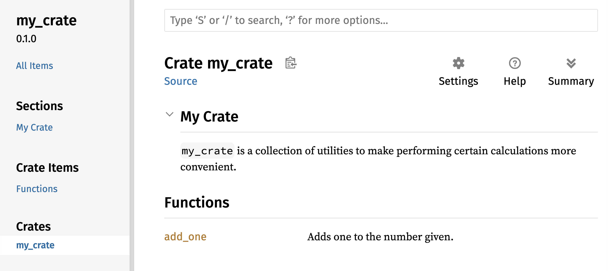

## Crate közzététele a Crates.io-n {#publishing-a-crate-to-cratesio}

A [crates.io](https://crates.io/)<!-- ignore --> csomagjait már használtuk a
projektünk függőségeiként, de a saját csomagjaid közzétételével te is
megoszthatod a kódodat másokkal. A [crates.io](https://crates.io/)<!-- ignore
--> crate-regisztere (registry) a csomagjaid forráskódját terjeszti, ezért
elsősorban nyílt forráskódú kódot tárol.

A Rust és a Cargo olyan funkciókat kínál, amelyek megkönnyítik, hogy mások
megtalálják és használják a közzétett csomagodat. A következőkben ezek közül
mutatunk be néhányat, majd elmagyarázzuk, hogyan tehetsz közzé egy csomagot.

### Hasznos dokumentációs kommentek írása {#making-useful-documentation-comments}

Ha pontosan dokumentálod a csomagjaidat, a többi felhasználó tudni fogja,
hogyan és mikor használja őket, ezért megéri időt fektetni a dokumentáció
megírásába. A 3. fejezetben megnéztük, hogyan kommentelhetjük a Rust-kódot két
perjellel (`//`). A Rustban van egy külön fajta komment is a dokumentációhoz,
amelyet kézenfekvő módon _dokumentációs kommentnek (documentation comment)_
nevezünk, és amelyből HTML-dokumentáció generálható. A HTML a nyilvános API
elemeihez írt dokumentációs kommentek tartalmát jeleníti meg, és azoknak a
programozóknak szól, akiket az érdekel, hogyan kell _használni_ a crate-edet,
nem pedig az, hogy hogyan van _megvalósítva_.

A dokumentációs kommentek két helyett három perjelet (`///`) használnak, és a
szöveg formázásához támogatják a Markdown jelölést. A dokumentációs kommentet
közvetlenül az általa dokumentált elem elé írd. A 14-1. kódrészlet egy
`my_crate` nevű crate `add_one` függvényének dokumentációs kommentjeit
mutatja.

<Listing number="14-1" file-name="src/lib.rs" caption="Egy függvény dokumentációs kommentje">

```rust,ignore
{{#rustdoc_include ../listings/ch14-more-about-cargo/listing-14-01/src/lib.rs}}
```

</Listing>

Itt leírjuk, mit csinál az `add_one` függvény, nyitunk egy `Examples` című
szakaszt, majd olyan kódot adunk meg, amely bemutatja az `add_one` függvény
használatát. Ebből a dokumentációs kommentből a `cargo doc` futtatásával
generálhatjuk a HTML-dokumentációt. Ez a parancs a Rusttal együtt terjesztett
`rustdoc` eszközt futtatja, és a generált HTML-dokumentációt a _target/doc_
mappába teszi.

Kényelmi okokból a `cargo doc --open` futtatása lebuildeli az aktuális crate
dokumentációjának HTML-jét (a crate összes függőségének dokumentációjával
együtt), és megnyitja az eredményt egy webböngészőben. Ha az `add_one`
függvényhez navigálsz, láthatod, hogyan jelenik meg a dokumentációs kommentek
szövege, ahogy a 14-1. ábra mutatja.


<span class="caption">14-1. ábra: Az `add_one` függvény
HTML-dokumentációja</span>

#### Gyakran használt szakaszok {#commonly-used-sections}

A 14-1. kódrészletben a `# Examples` Markdown-címsorral hoztunk létre egy
„Examples” című szakaszt a HTML-ben. Íme néhány további szakasz, amelyet a
crate-ek szerzői gyakran használnak a dokumentációjukban:

- **Panics**: Azok a helyzetek, amelyekben a dokumentált függvény pánikolhat.
  A függvény hívóinak, akik nem szeretnék, hogy a programjuk pánikoljon,
  ügyelniük kell arra, hogy ilyen helyzetekben ne hívják meg a függvényt.
- **Errors**: Ha a függvény `Result`-ot ad vissza, hasznos lehet a hívóknak
  leírni, milyen fajta hibák fordulhatnak elő, és milyen feltételek
  vezethetnek ezeknek a hibáknak a visszaadásához, hogy olyan kódot
  írhassanak, amely a különféle hibafajtákat különféleképpen kezeli.
- **Safety**: Ha a függvény hívása `unsafe` (a nem biztonságos kódról a 20.
  fejezetben lesz szó), legyen egy szakasz, amely elmagyarázza, miért nem
  biztonságos a függvény, és bemutatja azokat az invariánsokat, amelyek
  betartását a függvény elvárja a hívóitól.

A legtöbb dokumentációs kommentnek nincs szüksége ezek mindegyikére, de ez a
lista jó emlékeztető arra, hogy a kódod mely részleteire lesznek kíváncsiak a
felhasználók.

#### Dokumentációs kommentek mint tesztek {#documentation-comments-as-tests}

Ha a dokumentációs kommentjeidbe példakódblokkokat teszel, az segít bemutatni,
hogyan kell használni a könyvtáradat, és van egy további előnye is: a
`cargo test` futtatása tesztként lefuttatja a dokumentációdban lévő
kódpéldákat! Semmi sem jobb a példákkal ellátott dokumentációnál. De semmi
sem rosszabb, mint az olyan példák, amelyek nem működnek, mert a kód a
dokumentáció megírása óta megváltozott. Ha a 14-1. kódrészletben szereplő
`add_one` függvény dokumentációjával lefuttatjuk a `cargo test` parancsot, a
teszteredmények között egy ilyen szakaszt látunk:

<!-- manual-regeneration
cd listings/ch14-more-about-cargo/listing-14-01/
cargo test
copy just the doc-tests section below
-->

```text
   Doc-tests my_crate

running 1 test
test src/lib.rs - add_one (line 5) ... ok

test result: ok. 1 passed; 0 failed; 0 ignored; 0 measured; 0 filtered out; finished in 0.27s
```

Ha most úgy módosítjuk a függvényt vagy a példát, hogy a példában szereplő
`assert_eq!` pánikoljon, és újra lefuttatjuk a `cargo test` parancsot, látni
fogjuk, hogy a dokumentációs tesztek (doc tests) észreveszik, hogy a példa és
a kód már nincsenek összhangban egymással!

<!-- Old headings. Do not remove or links may break. -->

<a id="commenting-contained-items"></a>

#### A tartalmazó elem kommentjei {#contained-item-comments}

A `//!` stílusú dokumentációs komment ahhoz az elemhez ad dokumentációt,
amely a kommenteket _tartalmazza_, nem pedig a kommentek _után következő_
elemekhez. Ezeket a dokumentációs kommenteket jellemzően a crate-gyökér
fájljában (amely megállapodás szerint az _src/lib.rs_) vagy egy modulon belül
használjuk, hogy a crate-et vagy a modult egészében dokumentáljuk.

Ha például a `my_crate` crate céljának leírását szeretnénk dokumentálni
(amely az `add_one` függvényt tartalmazza), az _src/lib.rs_ fájl elejére
`//!`-lel kezdődő dokumentációs kommenteket írunk, ahogy a 14-2. kódrészlet
mutatja.

<Listing number="14-2" file-name="src/lib.rs" caption="A `my_crate` crate egészének dokumentációja">

```rust,ignore
{{#rustdoc_include ../listings/ch14-more-about-cargo/listing-14-02/src/lib.rs:here}}
```

</Listing>

Figyeld meg, hogy az utolsó, `//!`-lel kezdődő sor után nincs semmilyen kód.
Mivel a kommenteket `///` helyett `//!`-lel kezdtük, azt az elemet
dokumentáljuk, amely ezt a kommentet tartalmazza, nem pedig a komment után
következő elemet. Ebben az esetben ez az elem az _src/lib.rs_ fájl, vagyis a
crate-gyökér. Ezek a kommentek az egész crate-et írják le.

Ha lefuttatjuk a `cargo doc --open` parancsot, ezek a kommentek a `my_crate`
dokumentációjának kezdőlapján jelennek meg, a crate nyilvános elemeinek
listája fölött, ahogy a 14-2. ábra mutatja.

Az elemeken belüli dokumentációs kommentek különösen a crate-ek és a modulok
leírására hasznosak. Használd őket arra, hogy elmagyarázd a tároló átfogó
célját, és így segíts a felhasználóidnak megérteni a crate felépítését.



<span class="caption">14-2. ábra: A `my_crate` megjelenített dokumentációja,
benne a crate egészét leíró kommenttel</span>

<!-- Old headings. Do not remove or links may break. -->

<a id="exporting-a-convenient-public-api-with-pub-use"></a>

### Kényelmes nyilvános API exportálása {#exporting-a-convenient-public-api}

Egy crate közzétételekor a nyilvános API szerkezete fontos szempont. A crate-ed
felhasználói kevésbé ismerik a szerkezetét, mint te, és nehezen találhatják
meg a használni kívánt részeket, ha a crate-ednek nagy a modulhierarchiája.

A 7. fejezetben megnéztük, hogyan tehetünk nyilvánossá elemeket a `pub`
kulcsszóval, és hogyan hozhatunk elemeket hatókörbe a `use` kulcsszóval. Ám
az a szerkezet, amely a crate fejlesztése közben számodra logikus, nem
feltétlenül kényelmes a felhasználóid számára. Előfordulhat, hogy a
struktúráidat többszintű hierarchiába szeretnéd szervezni, de akkor azok, akik
egy, a hierarchia mélyén definiált típusodat szeretnék használni, nehezen
jöhetnek rá, hogy az a típus egyáltalán létezik. Az is bosszanthatja őket,
hogy `use my_crate::UsefulType;` helyett azt kell beírniuk, hogy `use
my_crate::some_module::another_module::UsefulType;`.

A jó hír az, hogy ha a szerkezet _nem_ kényelmes mások számára egy másik
könyvtárból való használathoz, nem kell átrendezned a belső felépítésedet:
ehelyett a `pub use` segítségével újraexportálhatod az elemeket, és így a
privát szerkezetedtől eltérő nyilvános szerkezetet hozhatsz létre. Az
_újraexportálás (re-exporting)_ egy adott helyen lévő nyilvános elemet egy
másik helyen is nyilvánossá tesz, mintha azt eleve ott definiálták volna.

Tegyük fel például, hogy készítettünk egy `art` nevű könyvtárat művészeti
fogalmak modellezésére. Ebben a könyvtárban két modul van: egy `kinds` modul,
amely két enumot tartalmaz `PrimaryColor` és `SecondaryColor` néven, valamint
egy `utils` modul, amely egy `mix` nevű függvényt tartalmaz, ahogy a 14-3.
kódrészlet mutatja.

<Listing number="14-3" file-name="src/lib.rs" caption="Egy `art` könyvtár, amelynek elemei a `kinds` és a `utils` modulba vannak szervezve">

```rust,noplayground,test_harness
{{#rustdoc_include ../listings/ch14-more-about-cargo/listing-14-03/src/lib.rs:here}}
```

</Listing>

A 14-3. ábra azt mutatja, hogyan nézne ki a `cargo doc` által generált
dokumentáció kezdőlapja ehhez a crate-hez.


<span class="caption">14-3. ábra: Az `art` dokumentációjának kezdőlapja, amely
a `kinds` és a `utils` modult listázza</span>

Figyeld meg, hogy a `PrimaryColor` és a `SecondaryColor` típus nem szerepel a
kezdőlapon, ahogy a `mix` függvény sem. Ahhoz, hogy lássuk őket, a `kinds`-ra
és a `utils`-ra kell kattintanunk.

Egy másik crate-nek, amely ettől a könyvtártól függ, olyan `use` utasításokra
lenne szüksége, amelyek az `art` elemeit hatókörbe hozzák, a jelenleg
definiált modulszerkezet megadásával. A 14-4. kódrészlet egy olyan crate-et
mutat be példaként, amely az `art` crate `PrimaryColor` és `mix` elemét
használja.

<Listing number="14-4" file-name="src/main.rs" caption="Az `art` crate elemeit használó crate, a belső szerkezet exportálásával">

```rust,ignore
{{#rustdoc_include ../listings/ch14-more-about-cargo/listing-14-04/src/main.rs}}
```

</Listing>

A 14-4. kódrészlet szerzőjének, aki az `art` crate-et használja, ki kellett
derítenie, hogy a `PrimaryColor` a `kinds` modulban, a `mix` pedig a `utils`
modulban van. Az `art` crate modulszerkezete inkább az `art` crate-en dolgozó
fejlesztőknek fontos, mint azoknak, akik használják. A belső szerkezet nem
tartalmaz hasznos információt annak, aki azt próbálja megérteni, hogyan kell
használni az `art` crate-et, sőt inkább zavart okoz, mert a crate-et használó
fejlesztőknek ki kell deríteniük, hol keressék az elemeket, és a `use`
utasításokban meg kell adniuk a modulneveket.

Ahhoz, hogy a belső felépítést eltávolítsuk a nyilvános API-ból, módosíthatjuk
a 14-3. kódrészletben szereplő `art` crate kódját: `pub use` utasításokat
adunk hozzá, amelyek a legfelső szinten újraexportálják az elemeket, ahogy a
14-5. kódrészlet mutatja.

<Listing number="14-5" file-name="src/lib.rs" caption="`pub use` utasítások hozzáadása az elemek újraexportálásához">

```rust,ignore
{{#rustdoc_include ../listings/ch14-more-about-cargo/listing-14-05/src/lib.rs:here}}
```

</Listing>

A `cargo doc` által ehhez a crate-hez generált API-dokumentáció most már a
kezdőlapon listázza és belinkeli az újraexportált elemeket, ahogy a 14-4. ábra
mutatja, így a `PrimaryColor` és a `SecondaryColor` típust, valamint a `mix`
függvényt könnyebb megtalálni.


<span class="caption">14-4. ábra: Az `art` dokumentációjának kezdőlapja, amely
az újraexportált elemeket listázza</span>

Az `art` crate felhasználói továbbra is láthatják és használhatják a 14-3.
kódrészlet belső szerkezetét, ahogy a 14-4. kódrészlet szemlélteti, vagy
használhatják a 14-5. kódrészlet kényelmesebb szerkezetét, ahogy a 14-6.
kódrészlet mutatja.

<Listing number="14-6" file-name="src/main.rs" caption="Az `art` crate újraexportált elemeit használó program">

```rust,ignore
{{#rustdoc_include ../listings/ch14-more-about-cargo/listing-14-06/src/main.rs:here}}
```

</Listing>

Ha sok egymásba ágyazott modul van, a típusok legfelső szintű újraexportálása
a `pub use` segítségével jelentősen javíthatja a crate felhasználóinak
élményét. A `pub use` egy másik gyakori felhasználása, hogy egy függőség
definícióit újraexportáljuk az aktuális crate-ben, így annak a crate-nek a
definíciói a te crate-ed nyilvános API-jának részévé válnak.

Egy hasznos nyilvános API-szerkezet kialakítása inkább művészet, mint
tudomány, és több lépésben is kikísérletezheted, melyik API működik a legjobban
a felhasználóid számára. A `pub use` választásával rugalmasan alakíthatod a
crate belső szerkezetét, és leválaszthatod ezt a belső szerkezetet arról, amit
a felhasználóidnak mutatsz. Nézz bele néhány általad telepített crate kódjába,
és nézd meg, eltér-e a belső szerkezetük a nyilvános API-juktól.

### Crates.io-fiók létrehozása {#setting-up-a-cratesio-account}

Mielőtt bármilyen crate-et közzétehetnél, létre kell hoznod egy fiókot a
[crates.io](https://crates.io/)<!-- ignore --> oldalon, és szerezned kell egy
API-tokent. Ehhez látogass el a [crates.io](https://crates.io/)<!-- ignore -->
kezdőlapjára, és jelentkezz be egy GitHub-fiókkal. (A GitHub-fiók jelenleg
követelmény, de a jövőben az oldal a fióklétrehozás más módjait is
támogathatja.) Miután bejelentkeztél, keresd fel a fiókbeállításaidat a
[https://crates.io/me/](https://crates.io/me/)<!-- ignore --> címen, és kérd
le az API-kulcsodat. Ezután futtasd a `cargo login` parancsot, és amikor a
program kéri, illeszd be az API-kulcsodat, így:

```console
$ cargo login
abcdefghijklmnopqrstuvwxyz012345
```

Ez a parancs közli a Cargóval az API-tokenedet, és helyben eltárolja a
_~/.cargo/credentials.toml_ fájlban. Ne feledd, hogy ez a token titkos: senki
mással ne oszd meg! Ha bármilyen okból mégis megosztottad valakivel, vond
vissza, és generálj egy új tokent a [crates.io](https://crates.io/)<!-- ignore
--> oldalon.

### Metaadatok hozzáadása egy új crate-hez {#adding-metadata-to-a-new-crate}

Tegyük fel, hogy van egy crate-ed, amelyet közzé szeretnél tenni. A
közzététel előtt néhány metaadatot kell hozzáadnod a crate _Cargo.toml_
fájljának `[package]` szakaszához.

A crate-ednek egyedi névre lesz szüksége. Amíg helyben dolgozol egy crate-en,
bárhogy elnevezheted. A [crates.io](https://crates.io/)<!-- ignore --> oldalon
viszont a crate-nevek kiosztása érkezési sorrendben történik. Ha egy
crate-nevet már lefoglaltak, senki más nem tehet közzé crate-et ezen a néven.
Mielőtt megpróbálnál közzétenni egy crate-et, keress rá a használni kívánt
névre. Ha a nevet már használják, másik nevet kell találnod, és a _Cargo.toml_
fájl `[package]` szakaszában a `name` mezőt át kell írnod, hogy a közzététel
az új névvel történjen, így:

<span class="filename">Fájlnév: Cargo.toml</span>

```toml
[package]
name = "guessing_game"
```

Még ha egyedi nevet választottál is, ha ezen a ponton a `cargo publish`
futtatásával megpróbálod közzétenni a crate-et, egy figyelmeztetést, majd egy
hibát kapsz:

<!-- manual-regeneration
Create a new package with an unregistered name, making no further modifications
  to the generated package, so it is missing the description and license fields.
cargo publish
copy just the relevant lines below
-->

```console
$ cargo publish
    Updating crates.io index
warning: manifest has no description, license, license-file, documentation, homepage or repository.
See https://doc.rust-lang.org/cargo/reference/manifest.html#package-metadata for more info.
--snip--
error: failed to publish to registry at https://crates.io

Caused by:
  the remote server responded with an error (status 400 Bad Request): missing or empty metadata fields: description, license. Please see https://doc.rust-lang.org/cargo/reference/manifest.html for more information on configuring these fields
```

A hiba azért lép fel, mert hiányzik néhány lényeges információ: a leírás és a
licenc kötelező, hogy az emberek tudják, mit csinál a crate-ed, és milyen
feltételekkel használhatják. A _Cargo.toml_ fájlban adj meg egy csupán egy-két
mondatos leírást, mert ez a keresési találatokban a crate-ed mellett fog
megjelenni. A `license` mezőhöz egy _licencazonosító értéket (license
identifier value)_ kell megadnod. A [Linux Foundation Software Package Data
Exchange (SPDX)][spdx] listája tartalmazza az ehhez az értékhez használható
azonosítókat. Ha például azt szeretnéd jelezni, hogy a crate-edet az MIT
licenc alatt teszed közzé, add hozzá az `MIT` azonosítót:

<span class="filename">Fájlnév: Cargo.toml</span>

```toml
[package]
name = "guessing_game"
license = "MIT"
```

Ha olyan licencet szeretnél használni, amely nem szerepel az SPDX-ben, akkor
az adott licenc szövegét egy fájlba kell tenned, a fájlt fel kell venned a
projektedbe, majd a `license` kulcs helyett a `license-file` kulccsal kell
megadnod a fájl nevét.

Annak eldöntése, hogy melyik licenc illik a projektedhez, túlmutat ennek a
könyvnek a keretein. A Rust-közösségben sokan ugyanúgy licencelik a
projektjeiket, mint maga a Rust, vagyis a `MIT OR Apache-2.0` kettős
licencet használják. Ez a gyakorlat azt is mutatja, hogy több, `OR`-ral
elválasztott licencazonosítót is megadhatsz, ha a projektedhez több licencet
szeretnél.

Az egyedi névvel, a verzióval, a leírással és a licenccel kiegészítve egy
közzétételre kész projekt _Cargo.toml_ fájlja így nézhet ki:

<span class="filename">Fájlnév: Cargo.toml</span>

```toml
[package]
name = "guessing_game"
version = "0.1.0"
edition = "2024"
description = "A fun game where you guess what number the computer has chosen."
license = "MIT OR Apache-2.0"

[dependencies]
```

[A Cargo dokumentációja](https://doc.rust-lang.org/cargo/) további
metaadatokat is ismertet, amelyek megadásával biztosíthatod, hogy mások
könnyebben megtalálják és használják a crate-edet.

### Közzététel a Crates.io-n {#publishing-to-cratesio}

Most, hogy létrehoztál egy fiókot, elmentetted az API-tokenedet, nevet
választottál a crate-ednek, és megadtad a szükséges metaadatokat, készen állsz
a közzétételre! Egy crate közzététele egy adott verziót feltölt a
[crates.io](https://crates.io/)<!-- ignore --> oldalra, hogy mások
használhassák.

Légy óvatos, mert a közzététel _végleges_. A verzió soha nem írható felül, és
a kód – bizonyos kivételes esetektől eltekintve – nem törölhető. A Crates.io
egyik fő célja, hogy a kód állandó archívumaként szolgáljon, így minden olyan
projekt buildje továbbra is működjön, amely a
[crates.io](https://crates.io/)<!-- ignore --> crate-jeitől függ. Ha a
verziók törlése megengedett lenne, ezt a célt lehetetlen volna teljesíteni. A
közzétehető crate-verziók számának viszont nincs korlátja.

Futtasd újra a `cargo publish` parancsot. Most már sikerülnie kell:

<!-- manual-regeneration
go to some valid crate, publish a new version
cargo publish
copy just the relevant lines below
-->

```console
$ cargo publish
    Updating crates.io index
   Packaging guessing_game v0.1.0 (file:///projects/guessing_game)
    Packaged 6 files, 1.2KiB (895.0B compressed)
   Verifying guessing_game v0.1.0 (file:///projects/guessing_game)
   Compiling guessing_game v0.1.0
(file:///projects/guessing_game/target/package/guessing_game-0.1.0)
    Finished `dev` profile [unoptimized + debuginfo] target(s) in 0.19s
   Uploading guessing_game v0.1.0 (file:///projects/guessing_game)
    Uploaded guessing_game v0.1.0 to registry `crates-io`
note: waiting for `guessing_game v0.1.0` to be available at registry
`crates-io`.
You may press ctrl-c to skip waiting; the crate should be available shortly.
   Published guessing_game v0.1.0 at registry `crates-io`
```

Gratulálunk! Megosztottad a kódodat a Rust-közösséggel, és most már bárki
könnyedén felveheti a crate-edet a projektje függőségei közé.

### Egy meglévő crate új verziójának közzététele {#publishing-a-new-version-of-an-existing-crate}

Ha módosítottad a crate-edet, és készen állsz egy új verzió kiadására, írd át
a _Cargo.toml_ fájlban megadott `version` értéket, és tedd közzé újra a
crate-et. A [szemantikus verziókezelés (Semantic Versioning)
szabályai][semver] alapján döntsd el, mi a megfelelő következő verziószám a
végrehajtott változtatások fajtájától függően. Ezután futtasd a
`cargo publish` parancsot az új verzió feltöltéséhez.

<!-- Old headings. Do not remove or links may break. -->

<a id="removing-versions-from-cratesio-with-cargo-yank"></a>
<a id="deprecating-versions-from-cratesio-with-cargo-yank"></a>

### Verziók elavulttá nyilvánítása a Crates.io-n {#deprecating-versions-from-cratesio}

Bár a crate korábbi verzióit nem távolíthatod el, megakadályozhatod, hogy a
jövőbeli projektek új függőségként vegyék fel őket. Ez akkor hasznos, ha egy
crate-verzió valamilyen okból hibás. Ilyen helyzetekre a Cargo támogatja a
crate-verziók visszavonását (yank).

Egy verzió _visszavonása (yanking)_ megakadályozza, hogy új projektek attól a
verziótól függjenek, de az összes meglévő, tőle függő projekt továbbra is
működhet. Lényegében a visszavonás azt jelenti, hogy egyetlen _Cargo.lock_
fájllal rendelkező projekt sem romlik el, a jövőben generált _Cargo.lock_
fájlok viszont nem fogják használni a visszavont verziót.

Egy crate valamely verziójának visszavonásához a korábban közzétett crate
mappájában futtasd a `cargo yank` parancsot, és add meg, melyik verziót
szeretnéd visszavonni. Ha például közzétettük a `guessing_game` nevű crate
1.0.1-es verzióját, és vissza szeretnénk vonni, akkor a `guessing_game`
projektmappájában a következőt futtatnánk:

<!-- manual-regeneration:
cargo yank carol-test --version 2.1.0
cargo yank carol-test --version 2.1.0 --undo
-->

```console
$ cargo yank --vers 1.0.1
    Updating crates.io index
        Yank guessing_game@1.0.1
```

Ha a parancshoz hozzáadod az `--undo` kapcsolót, a visszavonást
vissza is állíthatod, így a projektek ismét függhetnek az adott verziótól:

```console
$ cargo yank --vers 1.0.1 --undo
    Updating crates.io index
      Unyank guessing_game@1.0.1
```

A visszavonás _nem_ töröl semmilyen kódot. Nem tudja például törölni a
véletlenül feltöltött titkos adatokat. Ha ez történik, azonnal érvénytelenítsd
és cseréld le ezeket a titkos adatokat.

[spdx]: https://spdx.org/licenses/
[semver]: https://semver.org/
