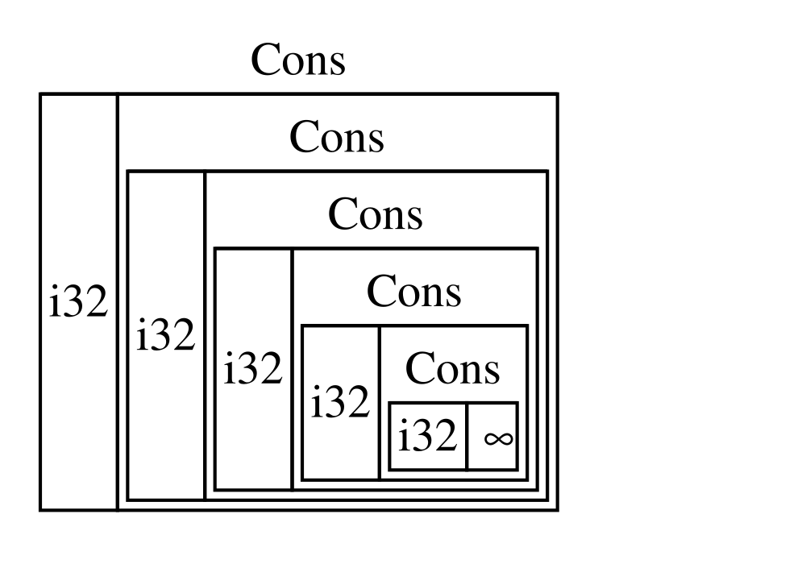
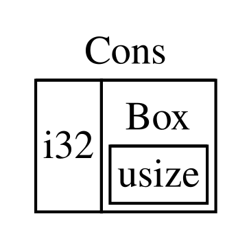

## A `Box<T>` használata a kupacon lévő adatokra mutatáshoz {#using-boxt-to-point-to-data-on-the-heap}

A legegyszerűbb okos mutató a box (doboz), amelynek típusát `Box<T>`-ként
írjuk. A _boxok (boxes)_ lehetővé teszik, hogy az adatokat a verem helyett a
kupacon tároljuk. A veremben csak a kupacon lévő adatra mutató mutató marad. A
verem és a kupac közötti különbséget a 4. fejezetben ismételheted át.

A boxoknak nincs teljesítménybeli többletköltségük azon kívül, hogy az adataikat
a verem helyett a kupacon tárolják. Viszont sok extra képességük sincs.
Leggyakrabban a következő helyzetekben fogod használni őket:

- Ha van egy típusod, amelynek a mérete fordítási időben nem ismert, és egy
  ilyen típusú értéket olyan környezetben szeretnél használni, amely pontos
  méretet követel meg
- Ha nagy mennyiségű adatod van, és át szeretnéd adni a tulajdonjogát, de
  biztosítani akarod, hogy közben az adat ne másolódjon
- Ha birtokolni szeretnél egy értéket, és csak az számít, hogy a típusa egy
  bizonyos traitet megvalósítson, nem pedig az, hogy egy konkrét típusú legyen

Az első helyzetet a [„Rekurzív típusok lehetővé tétele boxokkal”
](#enabling-recursive-types-with-boxes)<!-- ignore --> részben mutatjuk be. A
második esetben a nagy mennyiségű adat tulajdonjogának átadása sokáig tarthat,
mert az adat a veremben másolódik. A teljesítmény javítása érdekében ilyenkor a
nagy mennyiségű adatot egy boxban, a kupacon tárolhatjuk. Így csak a kis
méretű mutatóadat másolódik a veremben, míg az általa hivatkozott adat egy
helyen marad a kupacon. A harmadik esetet _trait objektumnak (trait object)_
nevezik, és a 18. fejezet [„Trait objektumok használata a közös viselkedés
absztrahálására”][trait-objects]<!-- ignore --> szakasza foglalkozik ezzel a
témával. Amit itt megtanulsz, azt abban a szakaszban ismét alkalmazni fogod!

<!-- Old headings. Do not remove or links may break. -->

<a id="using-boxt-to-store-data-on-the-heap"></a>

### Adatok tárolása a kupacon {#storing-data-on-the-heap}

Mielőtt rátérnénk a `Box<T>` kupacon való tárolásra szolgáló felhasználására,
megnézzük a szintaxist, és azt, hogyan dolgozhatunk a `Box<T>`-ben tárolt
értékekkel.

A 15-1. kódrészlet azt mutatja, hogyan tárolhatunk egy `i32` értéket a kupacon
egy box segítségével.

<Listing number="15-1" file-name="src/main.rs" caption="Egy `i32` érték tárolása a kupacon egy box segítségével">

```rust
{{#rustdoc_include ../listings/ch15-smart-pointers/listing-15-01/src/main.rs}}
```

</Listing>

A `b` változót úgy definiáljuk, hogy az értéke egy `Box` legyen, amely az `5`
értékre mutat, amely a kupacon van lefoglalva. A program kiírja, hogy `b = 5`;
ebben az esetben a boxban lévő adathoz ugyanúgy férhetünk hozzá, mintha az adat
a veremben lenne. Ahogy bármely saját tulajdonú érték esetén, amikor egy box
kikerül a hatókörből – ahogy a `b` a `main` végén –, felszabadul. A
felszabadítás a boxra (amely a veremben van) és az általa mutatott adatra
(amely a kupacon van) is vonatkozik.

Egyetlen érték kupacra helyezése nem túl hasznos, így a boxokat önmagukban
ritkán fogod így használni. A legtöbb helyzetben megfelelőbb, ha az olyan
értékek, mint egy egyedülálló `i32`, a veremben vannak, ahol alapértelmezés
szerint tárolódnak. Nézzünk meg egy olyan esetet, amelyben a boxok lehetővé
teszik olyan típusok definiálását, amelyeket boxok nélkül nem definiálhatnánk.

### Rekurzív típusok lehetővé tétele boxokkal {#enabling-recursive-types-with-boxes}

Egy _rekurzív típusú (recursive type)_ érték részeként tartalmazhat egy másik,
ugyanolyan típusú értéket. A rekurzív típusok problémát jelentenek, mert a
Rustnak fordítási időben tudnia kell, mennyi helyet foglal egy típus. A
rekurzív típusú értékek egymásba ágyazása azonban elméletileg a végtelenségig
folytatódhat, így a Rust nem tudhatja, mennyi helyre van szüksége az értéknek.
Mivel a boxok mérete ismert, a rekurzív típusokat úgy tehetjük lehetővé, hogy a
rekurzív típusdefinícióba egy boxot illesztünk.

A rekurzív típus példájaként nézzük meg a cons listát. Ez egy olyan adattípus,
amely a funkcionális programozási nyelvekben gyakori. Az általunk definiált
cons lista típus a rekurziótól eltekintve egyszerű; ezért a példában használt
fogalmak mindig hasznosak lesznek, amikor rekurzív típusokat érintő,
összetettebb helyzetekbe kerülsz.

<!-- Old headings. Do not remove or links may break. -->

<a id="more-information-about-the-cons-list"></a>

#### A cons lista megértése {#understanding-the-cons-list}

A _cons lista (cons list)_ a Lisp programozási nyelvből és annak
dialektusaiból származó adatszerkezet, amely egymásba ágyazott párokból áll, és
a láncolt lista Lisp-féle változata. A neve a Lisp `cons` függvényéből
(a _construct function_, azaz „létrehozó függvény” rövidítéséből) ered, amely a
két argumentumából egy új párt hoz létre. Ha a `cons`-t egy értékből és egy
másik párból álló páron hívjuk meg, rekurzív párokból álló cons listákat
hozhatunk létre.

Íme például egy cons lista pszeudokódos ábrázolása, amely az `1, 2, 3` listát
tartalmazza, és minden pár zárójelben van:

```text
(1, (2, (3, Nil)))
```

A cons lista minden eleme két részből áll: az aktuális elem értékéből és a
következő elemből. A lista utolsó eleme csak egy `Nil` nevű értéket tartalmaz,
következő elem nélkül. A cons listát a `cons` függvény rekurzív hívásával
állítjuk elő. A rekurzió alapesetének kanonikus neve a `Nil`. Figyelj arra,
hogy ez nem ugyanaz, mint a 6. fejezetben tárgyalt „null” vagy „nil” fogalom,
amely érvénytelen vagy hiányzó értéket jelent.

A cons lista nem gyakran használt adatszerkezet a Rustban. A legtöbbször, amikor
elemek listájára van szükséged a Rustban, a `Vec<T>` a jobb választás. Más,
összetettebb rekurzív adattípusok _valóban_ hasznosak különféle helyzetekben,
de ha ebben a fejezetben a cons listával kezdünk, különösebb figyelemelterelés
nélkül vizsgálhatjuk meg, hogyan teszik lehetővé a boxok rekurzív adattípusok
definiálását.

A 15-2. kódrészlet egy cons lista enumdefinícióját tartalmazza. Figyelj arra,
hogy ez a kód még nem fordul le, mert a `List` típus mérete nem ismert, ahogy
azt meg is mutatjuk.

<Listing number="15-2" file-name="src/main.rs" caption="Az első kísérlet egy `i32` értékekből álló cons lista adatszerkezetet ábrázoló enum definiálására">

```rust,ignore,does_not_compile
{{#rustdoc_include ../listings/ch15-smart-pointers/listing-15-02/src/main.rs:here}}
```

</Listing>

> Megjegyzés: Ebben a példában a szemléltetés kedvéért olyan cons listát
> valósítunk meg, amely csak `i32` értékeket tárol. Megvalósíthattuk volna
> generikus típusokkal is, ahogy a 10. fejezetben tárgyaltuk, hogy olyan cons
> lista típust definiáljunk, amely bármilyen típusú értéket tárolhat.

A `List` típus használata az `1, 2, 3` lista tárolására a 15-3. kódrészletben
látható kódhoz hasonlóan nézne ki.

<Listing number="15-3" file-name="src/main.rs" caption="Az `1, 2, 3` lista tárolása a `List` enum segítségével">

```rust,ignore,does_not_compile
{{#rustdoc_include ../listings/ch15-smart-pointers/listing-15-03/src/main.rs:here}}
```

</Listing>

Az első `Cons` érték az `1`-et és egy másik `List` értéket tárol. Ez a `List`
érték egy újabb `Cons` érték, amely a `2`-t és egy további `List` értéket tárol.
Ez a `List` érték megint egy `Cons` érték, amely a `3`-at és egy `List` értéket
tárol, ez utóbbi pedig végül a `Nil`, a nem rekurzív változat, amely a lista
végét jelzi.

Ha megpróbáljuk lefordítani a 15-3. kódrészlet kódját, a 15-4. kódrészletben
látható hibát kapjuk.

<Listing number="15-4" caption="A hiba, amelyet egy rekurzív enum definiálásának kísérletekor kapunk">

```console
{{#include ../listings/ch15-smart-pointers/listing-15-03/output.txt}}
```

</Listing>

A hiba azt mutatja, hogy ennek a típusnak „végtelen a mérete” (has infinite
size). Ennek az az oka, hogy a `List`-et egy rekurzív változattal definiáltuk:
közvetlenül tartalmaz egy másik, önmagával azonos típusú értéket. Emiatt a Rust
nem tudja kiszámítani, mennyi helyre van szüksége egy `List` érték tárolásához.
Nézzük meg részletesen, miért kapjuk ezt a hibát. Először azt vizsgáljuk meg,
hogyan dönti el a Rust, mennyi helyre van szüksége egy nem rekurzív típusú érték
tárolásához.

#### Egy nem rekurzív típus méretének kiszámítása {#computing-the-size-of-a-non-recursive-type}

Idézd fel a `Message` enumot, amelyet a 6-2. kódrészletben definiáltunk, amikor
a 6. fejezetben az enumdefiníciókat tárgyaltuk:

```rust
{{#rustdoc_include ../listings/ch06-enums-and-pattern-matching/listing-06-02/src/main.rs:here}}
```

Ahhoz, hogy meghatározza, mennyi helyet kell lefoglalnia egy `Message` érték
számára, a Rust végigmegy az összes változaton, hogy lássa, melyiknek van
szüksége a legtöbb helyre. A Rust látja, hogy a `Message::Quit`-nek nincs
szüksége helyre, a `Message::Move`-nak annyi helyre van szüksége, hogy két `i32`
értéket tárolhasson, és így tovább. Mivel egyszerre csak egy változat lesz
használatban, egy `Message` értéknek legfeljebb annyi helyre van szüksége,
amennyi a legnagyobb változatának tárolásához kell.

Vessük ezt össze azzal, ami akkor történik, amikor a Rust megpróbálja
meghatározni, mennyi helyre van szüksége egy rekurzív típusnak, például a
15-2. kódrészlet `List` enumjának. A fordító a `Cons` változat vizsgálatával
kezdi, amely egy `i32` típusú és egy `List` típusú értéket tárol. Ezért a
`Cons`-nak annyi helyre van szüksége, amennyi egy `i32` mérete plusz egy `List`
mérete. Hogy kiderítse, mennyi memóriára van szüksége a `List` típusnak, a
fordító megvizsgálja a változatokat, a `Cons` változattal kezdve. A `Cons`
változat egy `i32` típusú és egy `List` típusú értéket tárol, és ez a folyamat
a végtelenségig folytatódik, ahogy a 15-1. ábra mutatja.



<span class="caption">15-1. ábra: Végtelen sok `Cons` változatból álló,
végtelen `List`</span>

<!-- Old headings. Do not remove or links may break. -->

<a id="using-boxt-to-get-a-recursive-type-with-a-known-size"></a>

#### Ismert méretű rekurzív típus létrehozása {#getting-a-recursive-type-with-a-known-size}

Mivel a Rust nem tudja kiszámítani, mennyi helyet kell lefoglalnia a rekurzívan
definiált típusoknak, a fordító hibát ad ezzel a hasznos javaslattal:

<!-- manual-regeneration
after doing automatic regeneration, look at listings/ch15-smart-pointers/listing-15-03/output.txt and copy the relevant line
-->

```text
help: insert some indirection (e.g., a `Box`, `Rc`, or `&`) to break the cycle
  |
2 |     Cons(i32, Box<List>),
  |               ++++    +
```

Ebben a javaslatban az _indirekció (indirection)_ azt jelenti, hogy az érték
közvetlen tárolása helyett úgy kell módosítanunk az adatszerkezetet, hogy az
értéket közvetetten tárolja, vagyis egy, az értékre mutató mutatót tároljon.

Mivel a `Box<T>` egy mutató, a Rust mindig tudja, mennyi helyre van szüksége
egy `Box<T>`-nek: egy mutató mérete nem függ attól, mennyi adatra mutat. Ez azt
jelenti, hogy a `Cons` változatba közvetlenül egy másik `List` érték helyett
egy `Box<T>`-t tehetünk. A `Box<T>` a következő `List` értékre fog mutatni,
amely a kupacon lesz, nem pedig a `Cons` változaton belül. Elvileg továbbra is
listánk van, amely más listákat tartalmazó listákból áll, de ez a
megvalósítás most inkább olyan, mintha az elemeket egymás mellé helyeznénk,
nem pedig egymásba.

A 15-2. kódrészlet `List` enumjának definícióját és a 15-3. kódrészletbeli
`List`-használatot a 15-5. kódrészlet kódjára módosíthatjuk, amely már
lefordul.

<Listing number="15-5" file-name="src/main.rs" caption="A `List` definíciója, amely a `Box<T>`-t használja, hogy ismert mérete legyen">

```rust
{{#rustdoc_include ../listings/ch15-smart-pointers/listing-15-05/src/main.rs}}
```

</Listing>

A `Cons` változatnak egy `i32` méretére, valamint a box mutatóadatának
tárolásához szükséges helyre van szüksége. A `Nil` változat nem tárol értéket,
így kevesebb helyre van szüksége a veremben, mint a `Cons` változatnak. Most már
tudjuk, hogy bármely `List` érték egy `i32` méretét plusz egy box mutatóadatának
méretét foglalja el. A box használatával megtörtük a végtelen, rekurzív láncot,
így a fordító ki tudja számítani, mekkora méret kell egy `List` érték
tárolásához. A 15-2. ábra mutatja, hogyan néz ki most a `Cons` változat.



<span class="caption">15-2. ábra: Egy nem végtelen méretű `List`, mivel a
`Cons` egy `Box`-ot tartalmaz</span>

A boxok csak az indirekciót és a kupacon való foglalást biztosítják; nincs más
különleges képességük, mint azoknak, amelyeket a többi okos mutatótípusnál
látni fogunk. Nincs is meg az a teljesítménybeli többletköltségük, amellyel
ezek a különleges képességek járnak, így hasznosak lehetnek olyan esetekben,
mint a cons lista, ahol az indirekció az egyetlen funkció, amelyre szükségünk
van. A boxok további felhasználási módjait a 18. fejezetben nézzük meg.

A `Box<T>` típus azért okos mutató, mert megvalósítja a `Deref` traitet, amely
lehetővé teszi, hogy a `Box<T>` értékeket referenciaként kezeljük. Amikor egy
`Box<T>` érték kikerül a hatókörből, a box által mutatott kupacadat is
felszabadul a `Drop` trait megvalósítása miatt. Ez a két trait még fontosabb
lesz a fejezet hátralévő részében tárgyalt többi okos mutatótípus által nyújtott
funkcionalitás szempontjából. Vizsgáljuk meg ezt a két traitet részletesebben.

[trait-objects]: ch18-02-trait-objects.html#using-trait-objects-to-abstract-over-shared-behavior
