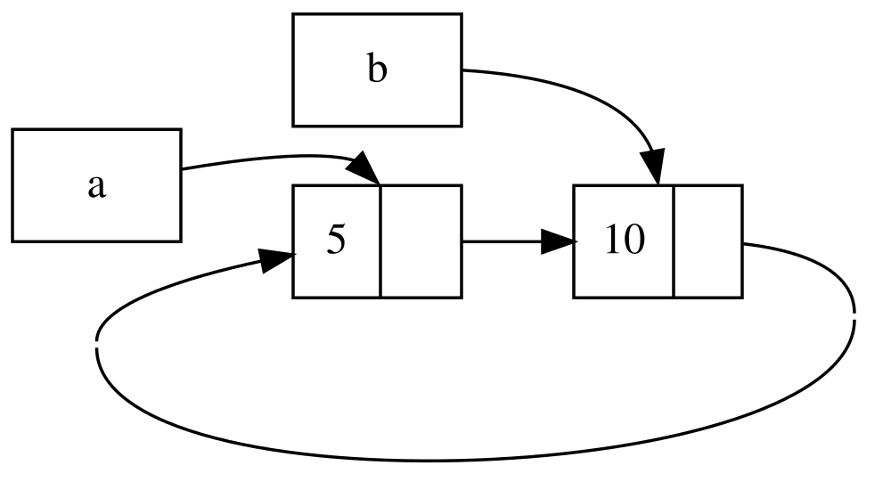

## A referenciaciklusok memóriaszivárgást okozhatnak {#reference-cycles-can-leak-memory}

A Rust memóriabiztonsági garanciái megnehezítik, de nem teszik lehetetlenné,
hogy véletlenül olyan memóriát hozzunk létre, amely soha nem szabadul fel
(ezt _memóriaszivárgásnak (memory leak)_ nevezzük). A memóriaszivárgás teljes
megakadályozása nem tartozik a Rust garanciái közé, vagyis a Rustban a
memóriaszivárgás memóriabiztos. Az `Rc<T>` és a `RefCell<T>` használatával
láthatjuk, hogy a Rust megengedi a memóriaszivárgást: létrehozhatók olyan
referenciák, amelyekben az elemek körbe hivatkoznak egymásra. Ez
memóriaszivárgást okoz, mert a ciklusban lévő elemek referenciaszáma soha nem
éri el a 0-t, így az értékek soha nem kerülnek eldobásra.

### Referenciaciklus létrehozása {#creating-a-reference-cycle}

Nézzük meg, hogyan jöhet létre egy _referenciaciklus (reference cycle)_, és
hogyan előzhetjük meg; kezdjük a `List` enum definíciójával és egy `tail`
metódussal a 15-25. kódrészletben.

<Listing number="15-25" file-name="src/main.rs" caption="Egy cons lista definíció, amely egy `RefCell<T>`-t tárol, hogy módosíthassuk, mire hivatkozik egy `Cons` változat">

```rust
{{#rustdoc_include ../listings/ch15-smart-pointers/listing-15-25/src/main.rs:here}}
```

</Listing>

A 15-5. kódrészletbeli `List` definíció egy újabb változatát használjuk. A
`Cons` változat második eleme most `RefCell<Rc<List>>`, ami azt jelenti, hogy
ahelyett, hogy – ahogy a 15-24. kódrészletben tettük – az `i32` értéket
módosíthatnánk, azt a `List` értéket szeretnénk módosítani, amelyre egy `Cons`
változat mutat. Egy `tail` metódust is hozzáadunk, hogy kényelmesen
hozzáférhessünk a második elemhez, ha van egy `Cons` változatunk.

A 15-26. kódrészletben egy `main` függvényt adunk hozzá, amely a 15-25.
kódrészlet definícióit használja. Ez a kód létrehoz egy listát az `a`-ban és
egy listát a `b`-ben, amely az `a`-ban lévő listára mutat. Ezután úgy
módosítja az `a`-ban lévő listát, hogy a `b`-re mutasson, így
referenciaciklust hoz létre. Menet közben `println!` utasítások mutatják,
mekkorák a referenciaszámok a folyamat különböző pontjain.

<Listing number="15-26" file-name="src/main.rs" caption="Két, egymásra mutató `List` értékből álló referenciaciklus létrehozása">

```rust
{{#rustdoc_include ../listings/ch15-smart-pointers/listing-15-26/src/main.rs:here}}
```

</Listing>

Létrehozunk egy `List` értéket tároló `Rc<List>` példányt az `a` változóban,
`5, Nil` kezdeti listával. Ezután létrehozunk egy másik `List` értéket tároló
`Rc<List>` példányt a `b` változóban, amely a `10` értéket tartalmazza, és az
`a`-ban lévő listára mutat.

Az `a`-t úgy módosítjuk, hogy a `Nil` helyett a `b`-re mutasson, így ciklust
hozunk létre. Ehhez a `tail` metódussal referenciát kérünk az `a`-ban lévő
`RefCell<Rc<List>>`-re, és ezt a `link` változóba tesszük. Ezután a
`RefCell<Rc<List>>`-en a `borrow_mut` metódussal a benne lévő értéket egy
`Nil` értéket tároló `Rc<List>`-ről a `b`-ben lévő `Rc<List>`-re cseréljük.

Ha ezt a kódot lefuttatjuk – az utolsó `println!`-t egyelőre kikommentezve
hagyva –, a következő kimenetet kapjuk:

```console
{{#include ../listings/ch15-smart-pointers/listing-15-26/output.txt}}
```

Az `a`-ban és a `b`-ben lévő `Rc<List>` példányok referenciaszáma egyaránt 2
lesz, miután az `a`-ban lévő listát a `b`-re irányítottuk. A `main` végén a
Rust eldobja a `b` változót, ami a `b` `Rc<List>` példányának referenciaszámát
2-ről 1-re csökkenti. Az `Rc<List>` kupacon lévő memóriája ezen a ponton nem
szabadul fel, mert a referenciaszáma 1, nem pedig 0. Ezután a Rust eldobja az
`a`-t, ami az `a` `Rc<List>` példányának referenciaszámát szintén 2-ről 1-re
csökkenti. Ennek a példánynak a memóriája sem szabadítható fel, mert a másik
`Rc<List>` példány még mindig hivatkozik rá. A listának lefoglalt memória
örökre felszabadítatlan marad. A referenciaciklus szemléltetésére elkészítettük
a 15-4. ábrán látható diagramot.



<span class="caption">15-4. ábra: Az egymásra mutató `a` és `b` lista
referenciaciklusa</span>

Ha visszaállítod az utolsó `println!`-t, és lefuttatod a programot, a Rust
megpróbálja kiírni ezt a ciklust – az `a` a `b`-re mutat, az az `a`-ra, és így
tovább –, amíg a verem túl nem csordul.

Egy valós programhoz képest a referenciaciklus létrehozásának következményei
ebben a példában nem túl súlyosak: rögtön a referenciaciklus létrehozása után
a program véget ér. Ha azonban egy összetettebb program sok memóriát foglalna
le egy ciklusban, és sokáig megtartaná, a program több memóriát használna a
szükségesnél, és túlterhelhetné a rendszert, amelynek így elfogyhatna a
rendelkezésre álló memóriája.

Referenciaciklust nem könnyű létrehozni, de nem is lehetetlen. Ha olyan
`RefCell<T>` értékeid vannak, amelyek `Rc<T>` értékeket tartalmaznak, vagy a
belső módosíthatóságú és referenciaszámláló típusok más, hasonló egymásba
ágyazott kombinációit használod, neked kell gondoskodnod arról, hogy ne hozz
létre ciklusokat; nem számíthatsz arra, hogy a Rust elkapja őket. Egy
referenciaciklus létrehozása logikai hiba lenne a programodban, amelyet
automatizált tesztekkel, kódátnézéssel és más szoftverfejlesztési
gyakorlatokkal érdemes a minimálisra csökkenteni.

A referenciaciklusok elkerülésének másik megoldása az adatszerkezetek olyan
átszervezése, hogy egyes referenciák tulajdonjogot fejezzenek ki, mások pedig
ne. Így olyan ciklusaid lehetnek, amelyek részben tulajdonosi, részben nem
tulajdonosi kapcsolatokból állnak, és csak a tulajdonosi kapcsolatok
befolyásolják, hogy egy érték eldobható-e. A 15-25. kódrészletben mindig azt
szeretnénk, hogy a `Cons` változatok birtokolják a listájukat, így az
adatszerkezet átszervezése nem lehetséges. Nézzünk egy példát szülő- és
gyermekcsúcsokból álló gráfokkal, hogy lássuk, mikor alkalmasak a nem
tulajdonosi kapcsolatok a referenciaciklusok megelőzésére.

<!-- Old headings. Do not remove or links may break. -->

<a id="preventing-reference-cycles-turning-an-rct-into-a-weakt"></a>

### Referenciaciklusok megelőzése a `Weak<T>` segítségével {#preventing-reference-cycles-using-weakt}

Eddig azt mutattuk meg, hogy az `Rc::clone` hívása megnöveli egy `Rc<T>`
példány `strong_count` értékét, és egy `Rc<T>` példány csak akkor szabadul
fel, ha a `strong_count` értéke 0. Egy `Rc<T>` példányon belüli értékre
_gyenge referenciát (weak reference)_ is létrehozhatsz, ha meghívod az
`Rc::downgrade`-et, és átadod neki az `Rc<T>`-re mutató referenciát. Az _erős
referenciák (strong references)_ segítségével osztozhatsz egy `Rc<T>` példány
tulajdonjogán. A _gyenge referenciák (weak references)_ nem fejeznek ki
tulajdonosi kapcsolatot, és a számuk nem befolyásolja, mikor szabadul fel egy
`Rc<T>` példány. Nem okoznak referenciaciklust, mert minden olyan ciklus,
amelyben gyenge referenciák is részt vesznek, megszakad, amint az érintett
értékek erős referenciaszáma 0 lesz.

Az `Rc::downgrade` hívásakor egy `Weak<T>` típusú okos mutatót kapsz. Ahelyett,
hogy az `Rc<T>` példány `strong_count` értékét 1-gyel növelné, az
`Rc::downgrade` hívása a `weak_count` értékét növeli 1-gyel. Az `Rc<T>` típus
a `strong_count`-hoz hasonlóan a `weak_count` segítségével tartja nyilván,
hány `Weak<T>` referencia létezik. A különbség az, hogy a `weak_count`
értékének nem kell 0-nak lennie ahhoz, hogy az `Rc<T>` példány felszabaduljon.

Mivel az az érték, amelyre a `Weak<T>` hivatkozik, már eldobásra kerülhetett,
ahhoz, hogy bármit tegyél azzal az értékkel, amelyre egy `Weak<T>` mutat, meg
kell győződnöd arról, hogy az érték még létezik. Ezt úgy teheted meg, hogy egy
`Weak<T>` példányon meghívod az `upgrade` metódust, amely egy
`Option<Rc<T>>`-t ad vissza. `Some` eredményt kapsz, ha az `Rc<T>` értéket
még nem dobták el, és `None` eredményt, ha az `Rc<T>` értéket már eldobták.
Mivel az `upgrade` `Option<Rc<T>>`-t ad vissza, a Rust biztosítja, hogy a
`Some` és a `None` esetet is kezeld, így nem lesz érvénytelen mutató.

Példaként egy olyan lista helyett, amelynek elemei csak a következő elemről
tudnak, egy olyan fát készítünk, amelynek elemei a gyermekelemeikről _és_ a
szülőelemeikről is tudnak.

<!-- Old headings. Do not remove or links may break. -->

<a id="creating-a-tree-data-structure-a-node-with-child-nodes"></a>

#### Fa adatszerkezet létrehozása {#creating-a-tree-data-structure}

Kezdésként egy olyan fát építünk, amelynek csúcsai tudnak a
gyermekcsúcsaikról. Létrehozunk egy `Node` nevű struktúrát, amely a saját
`i32` értékét, valamint a gyermek `Node` értékeire mutató referenciákat
tárolja:

<span class="filename">Fájlnév: src/main.rs</span>

```rust
{{#rustdoc_include ../listings/ch15-smart-pointers/listing-15-27/src/main.rs:here}}
```

Azt szeretnénk, hogy egy `Node` birtokolja a gyermekeit, és ezen a
tulajdonjogon változókkal is osztozni szeretnénk, hogy a fa minden `Node`-jához
közvetlenül hozzáférhessünk. Ehhez a `Vec<T>` elemeit `Rc<Node>` típusú
értékként definiáljuk. Azt is szeretnénk módosítani, hogy mely csúcsok egy
másik csúcs gyermekei, ezért a `children` mezőben egy `RefCell<T>` veszi körül
a `Vec<Rc<Node>>`-t.

Ezután a struktúradefiníciónk segítségével létrehozunk egy `leaf` nevű `Node`
példányt a `3` értékkel és gyermekek nélkül, valamint egy másik, `branch` nevű
példányt az `5` értékkel, amelynek egyik gyermeke a `leaf`, ahogy a 15-27.
kódrészlet mutatja.

<Listing number="15-27" file-name="src/main.rs" caption="Egy gyermek nélküli `leaf` csúcs és egy `branch` csúcs létrehozása, amelynek egyik gyermeke a `leaf`">

```rust
{{#rustdoc_include ../listings/ch15-smart-pointers/listing-15-27/src/main.rs:there}}
```

</Listing>

Klónozzuk a `leaf`-ben lévő `Rc<Node>`-ot, és a `branch`-ben tároljuk, ami
azt jelenti, hogy a `leaf`-ben lévő `Node`-nak most két tulajdonosa van: a
`leaf` és a `branch`. A `branch`-ből a `branch.children` segítségével
eljuthatunk a `leaf`-hez, de a `leaf`-ből nem lehet eljutni a `branch`-hez.
Ennek az az oka, hogy a `leaf`-nek nincs referenciája a `branch`-re, és nem
tudja, hogy kapcsolatban állnak. Azt szeretnénk, hogy a `leaf` tudja, hogy a
`branch` a szülője. Ezt tesszük meg a következőkben.

#### Referencia hozzáadása a gyermektől a szülőhöz {#adding-a-reference-from-a-child-to-its-parent}

Ahhoz, hogy a gyermekcsúcs tudjon a szülőjéről, egy `parent` mezőt kell
hozzáadnunk a `Node` struktúradefiníciónkhoz. A nehézség abban áll, hogy
eldöntsük, milyen típusú legyen a `parent`. Tudjuk, hogy nem tartalmazhat
`Rc<T>`-t, mert az referenciaciklust hozna létre: a `leaf.parent` a `branch`-re,
a `branch.children` pedig a `leaf`-re mutatna, ami miatt a `strong_count`
értékük soha nem lenne 0.

Ha másképp gondolunk a kapcsolatokra: egy szülőcsúcsnak birtokolnia kell a
gyermekeit: ha egy szülőcsúcsot eldobunk, a gyermekcsúcsait is el kell dobni.
Egy gyermek azonban nem birtokolhatja a szülőjét: ha eldobunk egy
gyermekcsúcsot, a szülőnek továbbra is léteznie kell. Ez a gyenge referenciák
esete!

Ezért az `Rc<T>` helyett a `parent` típusa a `Weak<T>`-t fogja használni,
pontosabban `RefCell<Weak<Node>>` lesz. A `Node` struktúradefiníciónk most így
néz ki:

<span class="filename">Fájlnév: src/main.rs</span>

```rust
{{#rustdoc_include ../listings/ch15-smart-pointers/listing-15-28/src/main.rs:here}}
```

Egy csúcs így hivatkozhat a szülőcsúcsára, de nem birtokolja azt. A 15-28.
kódrészletben úgy módosítjuk a `main`-t, hogy ezt az új definíciót használja,
így a `leaf` csúcs hivatkozhat a szülőjére, a `branch`-re.

<Listing number="15-28" file-name="src/main.rs" caption="Egy `leaf` csúcs, amely gyenge referenciával mutat a szülőcsúcsára, a `branch`-re">

```rust
{{#rustdoc_include ../listings/ch15-smart-pointers/listing-15-28/src/main.rs:there}}
```

</Listing>

A `leaf` csúcs létrehozása a `parent` mező kivételével a 15-27. kódrészlethez
hasonlóan néz ki: a `leaf` kezdetben szülő nélkül indul, ezért egy új, üres
`Weak<Node>` referenciapéldányt hozunk létre.

Ezen a ponton, amikor az `upgrade` metódussal megpróbálunk referenciát kapni a
`leaf` szülőjére, `None` értéket kapunk. Ezt az első `println!` utasítás
kimenetében látjuk:

```text
leaf parent = None
```

Amikor létrehozzuk a `branch` csúcsot, annak `parent` mezőjében is egy új
`Weak<Node>` referencia lesz, mert a `branch`-nek nincs szülőcsúcsa. A `leaf`
továbbra is a `branch` egyik gyermeke. Miután a `branch`-ben megvan a `Node`
példány, módosíthatjuk a `leaf`-et, hogy egy `Weak<Node>` referenciát adjunk
neki a szülőjére. A `leaf` `parent` mezőjében lévő `RefCell<Weak<Node>>`-en
meghívjuk a `borrow_mut` metódust, majd az `Rc::downgrade` függvénnyel a
`branch`-ben lévő `Rc<Node>`-ból egy `branch`-re mutató `Weak<Node>`
referenciát hozunk létre.

Amikor ismét kiírjuk a `leaf` szülőjét, ezúttal egy `branch`-et tartalmazó
`Some` változatot kapunk: a `leaf` most már hozzáfér a szülőjéhez! Amikor a
`leaf`-et kiírjuk, azt a ciklust is elkerüljük, amely a 15-26. kódrészletben
végül veremtúlcsorduláshoz vezetett; a `Weak<Node>` referenciák `(Weak)`
alakban jelennek meg:

```text
leaf parent = Some(Node { value: 5, parent: RefCell { value: (Weak) },
children: RefCell { value: [Node { value: 3, parent: RefCell { value: (Weak) },
children: RefCell { value: [] } }] } })
```

A végtelen kimenet hiánya azt jelzi, hogy ez a kód nem hozott létre
referenciaciklust. Ezt az `Rc::strong_count` és az `Rc::weak_count`
hívásával kapott értékekből is megállapíthatjuk.

#### A `strong_count` és a `weak_count` változásainak szemléltetése {#visualizing-changes-to-strong_count-and-weak_count}

Nézzük meg, hogyan változik az `Rc<Node>` példányok `strong_count` és
`weak_count` értéke, ha létrehozunk egy új belső hatókört, és a `branch`
létrehozását ebbe a hatókörbe helyezzük át. Így láthatjuk, mi történik, amikor
a `branch` létrejön, majd eldobásra kerül, amikor kikerül a hatókörből. A
módosításokat a 15-29. kódrészlet mutatja.

<Listing number="15-29" file-name="src/main.rs" caption="A `branch` létrehozása egy belső hatókörben, valamint az erős és gyenge referenciaszámok vizsgálata">

```rust
{{#rustdoc_include ../listings/ch15-smart-pointers/listing-15-29/src/main.rs:here}}
```

</Listing>

A `leaf` létrehozása után az `Rc<Node>`-jának erős referenciaszáma 1, gyenge
referenciaszáma pedig 0. A belső hatókörben létrehozzuk a `branch`-et, és
összekapcsoljuk a `leaf`-fel; ekkor a számok kiírásakor a `branch`-ben lévő
`Rc<Node>` erős referenciaszáma 1, gyenge referenciaszáma pedig 1 lesz (mivel
a `leaf.parent` egy `Weak<Node>`-dal a `branch`-re mutat). Amikor a `leaf`
számait írjuk ki, látjuk, hogy az erős referenciaszáma 2 lesz, mert a `branch`
a `branch.children`-ben tárolja a `leaf` `Rc<Node>`-jának egy klónját, a
gyenge referenciaszáma azonban továbbra is 0.

Amikor a belső hatókör véget ér, a `branch` kikerül a hatókörből, és az
`Rc<Node>` erős referenciaszáma 0-ra csökken, így a `Node`-ja eldobásra kerül.
A `leaf.parent`-ből származó 1-es gyenge referenciaszám nem befolyásolja, hogy
a `Node` eldobásra kerül-e, így nem lesz memóriaszivárgás!

Ha a hatókör vége után próbálunk hozzáférni a `leaf` szülőjéhez, ismét `None`
értéket kapunk. A program végén a `leaf`-ben lévő `Rc<Node>` erős
referenciaszáma 1, gyenge referenciaszáma pedig 0, mert most ismét a `leaf`
változó az egyetlen referencia az `Rc<Node>`-ra.

A számlálókat és az értékek eldobását kezelő teljes logika be van építve az
`Rc<T>`-be és a `Weak<T>`-be, valamint a `Drop` trait általuk adott
megvalósításaiba. Ha a `Node` definíciójában megadod, hogy a gyermektől a
szülőhöz vezető kapcsolat `Weak<T>` referencia legyen, a szülőcsúcsok
mutathatnak a gyermekcsúcsokra és fordítva, anélkül hogy referenciaciklus és
memóriaszivárgás jönne létre.

## Összefoglalás {#summary}

Ez a fejezet azt mutatta be, hogyan használhatunk okos mutatókat ahhoz, hogy a
Rust által a hagyományos referenciákkal alapértelmezésként nyújtottaktól eltérő
garanciákat és kompromisszumokat kapjunk. A `Box<T>` típus mérete ismert, és a
kupacon lefoglalt adatra mutat. Az `Rc<T>` típus nyilvántartja a kupacon lévő
adatra mutató referenciák számát, így az adatnak több tulajdonosa is lehet. A
`RefCell<T>` típus a belső módosíthatóságával olyan típust ad, amelyet akkor
használhatunk, amikor nem módosítható típusra van szükségünk, de meg kell
változtatnunk a típus egy belső értékét; emellett a kölcsönzési szabályokat
fordítási idő helyett futásidőben kényszeríti ki.

Szó volt a `Deref` és a `Drop` traitről is, amelyek az okos mutatók
funkcionalitásának jelentős részét lehetővé teszik. Megvizsgáltuk a
memóriaszivárgást okozó referenciaciklusokat, és azt, hogyan előzhetjük meg
őket a `Weak<T>` segítségével.

Ha ez a fejezet felkeltette az érdeklődésedet, és saját okos mutatókat
szeretnél megvalósítani, további hasznos információkért nézd meg a [„The
Rustonomicon”][nomicon] című könyvet.

A következő fejezetben a Rust konkurenciakezeléséről lesz szó. Néhány új okos
mutatóval is megismerkedsz majd.

[nomicon]: ../nomicon/index.html
