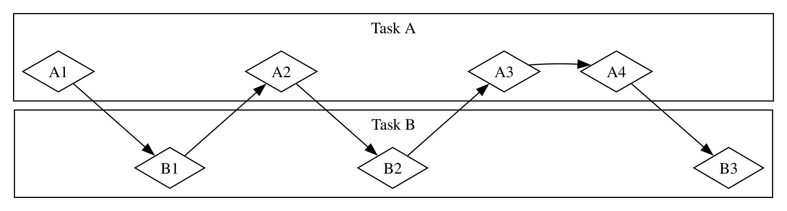
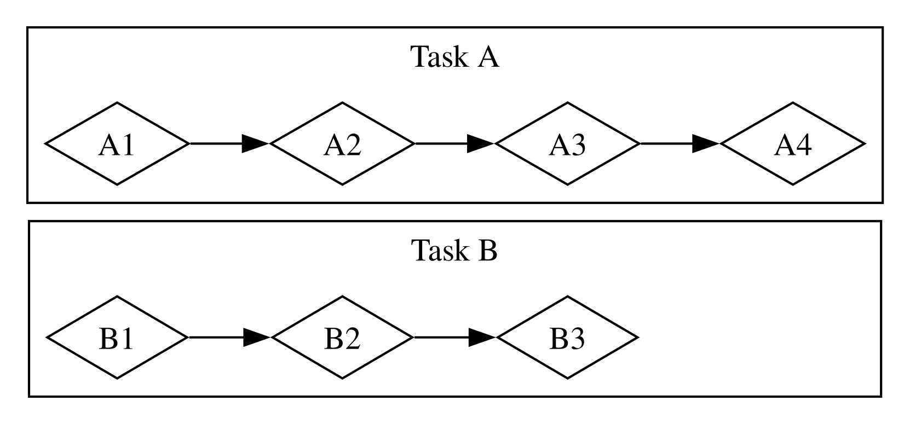
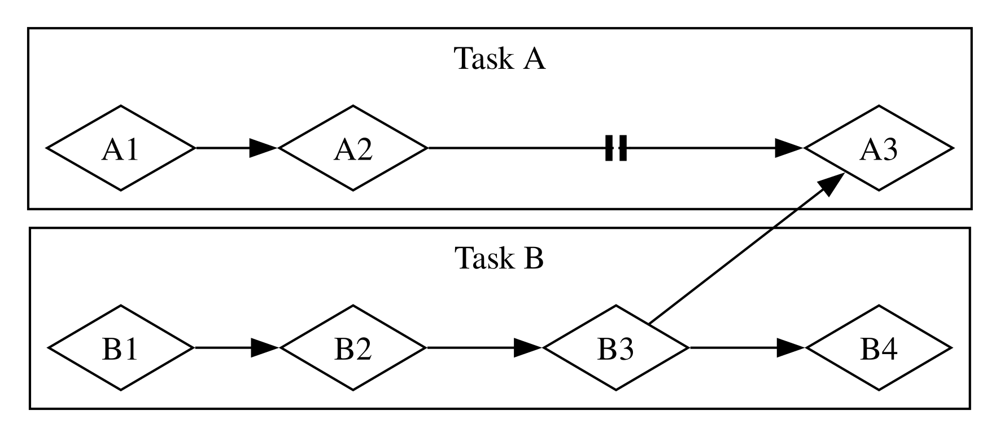

# Az aszinkron programozás alapjai: async, await, futures és streamek {#fundamentals-of-asynchronous-programming-async-await-futures-and-streams}

Sok művelet, amelyet a számítógéptől kérünk, eltarthat egy ideig. Jó lenne, ha
valami mást csinálhatnánk, amíg ezekre a hosszan futó folyamatokra várunk. A
modern számítógépek két módszert kínálnak arra, hogy egyszerre több műveleten
dolgozzanak: a párhuzamosságot és a konkurenciát. A programjaink logikáját
azonban többnyire lineárisan írjuk meg. Szeretnénk megadni, milyen műveleteket
végezzen el a program, és azt is, hogy hol állhat meg egy függvény, hogy
helyette a program egy másik része fusson – anélkül, hogy előre pontosan
meghatároznánk, milyen sorrendben és módon fusson az egyes kódrészek. Az
_aszinkron programozás (asynchronous programming)_ olyan absztrakció, amellyel
a kódunkat lehetséges megállási pontok és majdan megérkező eredmények
segítségével fejezhetjük ki, és amely a koordináció részleteit elvégzi
helyettünk.

Ez a fejezet a 16. fejezetre épít, ahol szálakat használtunk a párhuzamossághoz
és a konkurenciához, és egy másik megközelítést mutat be a kódíráshoz: a Rust
future-jeit, streamjeit, valamint az `async` és `await` szintaxist, amelyekkel
kifejezhetjük, hogy a műveletek hogyan lehetnek aszinkronok, továbbá azokat a
külső crate-eket, amelyek _aszinkron futtatókörnyezeteket (async runtimes)_
valósítanak meg: olyan kódot, amely az aszinkron műveletek végrehajtását
kezeli és koordinálja.

Nézzünk egy példát! Tegyük fel, hogy egy családi ünnepségről készített videót
exportálsz – ez a művelet percektől órákig bármennyi ideig tarthat. A
videóexportálás annyi CPU- és GPU-teljesítményt használ, amennyit csak tud. Ha
csak egyetlen CPU-magod lenne, és az operációs rendszer nem szakítaná meg az
exportálást, amíg az be nem fejeződik – vagyis _szinkron (synchronously)_ módon
hajtaná végre –, akkor semmi mást nem tudnál csinálni a számítógépeden, amíg ez
a feladat fut. Ez meglehetősen frusztráló élmény lenne. Szerencsére a
számítógéped operációs rendszere képes rá – és meg is teszi –, hogy
láthatatlanul elég gyakran megszakítsa az exportálást ahhoz, hogy közben más
munkát is elvégezhess.

Most tegyük fel, hogy egy valaki más által megosztott videót töltesz le, ami
szintén eltarthat egy ideig, de nem foglal annyi CPU-időt. Ebben az esetben a
CPU-nak arra kell várnia, hogy az adatok megérkezzenek a hálózatról. Bár az
adatokat már akkor elkezdheted olvasni, amikor elkezdenek beérkezni, eltarthat
egy ideig, amíg mind megérkezik. Még ha minden adat meg is van, ha a videó elég
nagy, legalább egy-két másodpercig tarthat a teljes betöltése. Ez talán nem
hangzik soknak, de egy modern processzor számára, amely másodpercenként
milliárdnyi műveletet tud elvégezni, nagyon hosszú idő. Az operációs rendszer
itt is láthatatlanul megszakítja a programot, hogy a CPU más munkát
végezhessen, amíg a hálózati hívás befejeződésére vár.

A videóexportálás a _CPU-korlátos (CPU-bound)_ vagy _számításkorlátos
(compute-bound)_ műveletek egy példája. Azt a számítógép CPU-n vagy GPU-n belüli
lehetséges adatfeldolgozási sebessége korlátozza, valamint az, hogy ebből a
sebességből mennyit tud a műveletre fordítani. A videóletöltés az _I/O-korlátos
(I/O-bound)_ műveletek egy példája, mert a számítógép _bemenetének és
kimenetének (input and output)_ sebessége korlátozza; csak olyan gyorsan
haladhat, amilyen gyorsan az adatokat a hálózaton át lehet küldeni.

Mindkét példában az operációs rendszer láthatatlan megszakításai egyfajta
konkurenciát biztosítanak. Ez a konkurencia azonban csak a teljes program
szintjén valósul meg: az operációs rendszer megszakít egy programot, hogy más
programok is haladhassanak a munkájukkal. Sok esetben – mivel a programjainkat
sokkal finomabb szinten értjük, mint az operációs rendszer – olyan
konkurencialehetőségeket is észrevehetünk, amelyeket az operációs rendszer nem
lát.

Ha például egy fájlletöltéseket kezelő eszközt készítünk, a programot úgy
kellene megírnunk, hogy egy letöltés elindítása ne fagyassza le a felhasználói
felületet, és a felhasználók egyszerre több letöltést is indíthassanak. Az
operációs rendszerek hálózatkezelő API-jainak jelentős része azonban
_blokkoló (blocking)_; vagyis feltartják a program előrehaladását, amíg a
feldolgozott adatok teljesen el nem készülnek.

> Megjegyzés: Ha jobban belegondolsz, a _legtöbb_ függvényhívás így működik. A
> _blokkoló_ kifejezést azonban általában azokra a függvényhívásokra
> használjuk, amelyek fájlokkal, a hálózattal vagy a számítógép más
> erőforrásaival dolgoznak, mert ezek azok az esetek, amikor egy programnak
> előnyös lenne, ha a művelet _nem_ blokkoló lenne.

A fő szál blokkolását elkerülhetnénk, ha minden fájl letöltéséhez külön szálat
indítanánk. Az ezek által a szálak által használt rendszererőforrások
többletterhelése azonban előbb-utóbb problémát okozna. Jobb lenne, ha a hívás
eleve nem blokkolna, és ehelyett megadhatnánk egy sor feladatot, amelyet a
programunknak el kell végeznie, és a futtatókörnyezetre bíznánk, hogy milyen
sorrendben és módon futtassa őket a legjobban.

Pontosan ezt adja nekünk a Rust _async_ (az _asynchronous_, azaz aszinkron
rövidítése) absztrakciója. Ebben a fejezetben mindent megtudsz az asyncről,
miközben a következő témákat tárgyaljuk:

- Hogyan használjuk a Rust `async` és `await` szintaxisát, és hogyan
  hajtsunk végre aszinkron függvényeket egy futtatókörnyezettel
- Hogyan oldjunk meg az async modellel néhányat azokból a problémákból,
  amelyeket a 16. fejezetben vizsgáltunk
- Hogyan nyújtanak egymást kiegészítő megoldásokat a többszálúság és az async,
  amelyeket sok esetben kombinálhatunk

Mielőtt azonban megnéznénk, hogyan működik az async a gyakorlatban, egy rövid
kitérőt kell tennünk, hogy megbeszéljük a párhuzamosság és a konkurencia
közötti különbségeket.

## Párhuzamosság és konkurencia {#parallelism-and-concurrency}

Eddig a párhuzamosságot és a konkurenciát többnyire felcserélhetőként kezeltük.
Most pontosabban meg kell különböztetnünk őket, mert a különbségek meg fognak
mutatkozni, amikor munkához látunk.

Gondoljuk végig, milyen különböző módokon oszthatja fel egy csapat egy
szoftverprojekt munkáját. Egyetlen tagra több feladatot is bízhatsz, minden
tagnak adhatsz egy-egy feladatot, vagy kombinálhatod a két megközelítést.

Amikor valaki több különböző feladaton dolgozik, mielőtt bármelyiket
befejezné, az a _konkurencia (concurrency)_. A konkurencia megvalósításának
egyik módja hasonló ahhoz, mint amikor két különböző projekt van kicsekkolva a
számítógépeden, és ha az egyikbe beleunsz vagy elakadsz vele, átváltasz a
másikra. Csak egy ember vagy, így nem tudsz mindkét feladaton pontosan
ugyanabban az időben haladni, de végezhetsz több feladatot egyszerre, úgy, hogy
egyszerre egyen haladsz, és váltogatsz közöttük (lásd a 17-1. ábrát).

<figure>

<figcaption>17-1. ábra: Konkurens munkafolyamat, amely Task A és Task B között váltogat</figcaption>

</figure>

Amikor a csapat úgy osztja fel a feladatok egy csoportját, hogy minden tag
egy-egy feladatot vállal, és egyedül dolgozik rajta, az a _párhuzamosság
(parallelism)_. A csapat minden tagja pontosan ugyanabban az időben haladhat
(lásd a 17-2. ábrát).

<figure>

<figcaption>17-2. ábra: Párhuzamos munkafolyamat, amelyben a Task A és a Task B munkája egymástól függetlenül zajlik</figcaption>

</figure>

Mindkét munkafolyamatban szükség lehet a különböző feladatok közötti
koordinációra. Lehet, hogy azt hitted, az egyik embernek kiosztott feladat
teljesen független mindenki más munkájától, de valójában szükség van rá, hogy a
csapat egy másik tagja előbb befejezze a saját feladatát. A munka egy része
elvégezhető párhuzamosan, de egy része valójában _soros (serial)_ volt: csak
sorban, egyik feladat a másik után történhetett, ahogy a 17-3. ábrán látható.

<figure>

<figcaption>17-3. ábra: Részben párhuzamos munkafolyamat, amelyben a Task A és a Task B munkája egymástól függetlenül zajlik, amíg az A3 feladat nem blokkolódik a B3 feladat eredményére várva.</figcaption>

</figure>

Hasonlóképpen rájöhetsz, hogy az egyik saját feladatod egy másik saját
feladatodtól függ. Ekkor a konkurens munkád is soros lett.

A párhuzamosság és a konkurencia egymást metszheti is. Ha megtudod, hogy egy
kollégád elakadt, amíg be nem fejezed az egyik feladatodat, valószínűleg minden
erődet arra a feladatra összpontosítod, hogy „feloldd” a kollégád blokkolását.
Te és a munkatársad ekkor már nem tudtok párhuzamosan dolgozni, és te sem
tudsz már konkurensen dolgozni a saját feladataidon.

Ugyanezek az alapvető mechanizmusok érvényesülnek a szoftvereknél és a
hardvereknél is. Egy egymagos CPU-val rendelkező gépen a CPU egyszerre csak
egy műveletet tud végrehajtani, de ettől még dolgozhat konkurensen. Olyan
eszközökkel, mint a szálak, a folyamatok és az async, a számítógép
szüneteltethet egy tevékenységet, és átválthat másokra, mielőtt végül
visszatérne az első tevékenységhez. Egy többmagos CPU-val rendelkező gépen
párhuzamosan is végezhet munkát. Az egyik mag végezhet egy feladatot, miközben
egy másik mag egy teljesen független feladatot végez, és ezek a műveletek
valóban egy időben történnek.

Az async kód futtatása a Rustban általában konkurensen történik. A hardvertől,
az operációs rendszertől és az általunk használt aszinkron futtatókörnyezettől
függően (az aszinkron futtatókörnyezetekről hamarosan bővebben is szó lesz) ez
a konkurencia a háttérben párhuzamosságot is használhat.

Most pedig merüljünk el abban, hogyan is működik valójában az aszinkron
programozás a Rustban!
