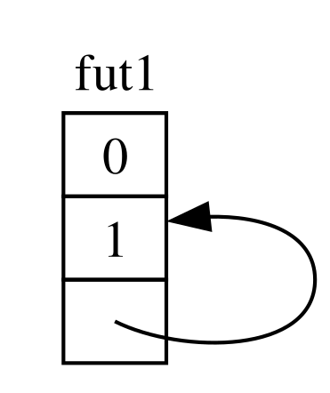
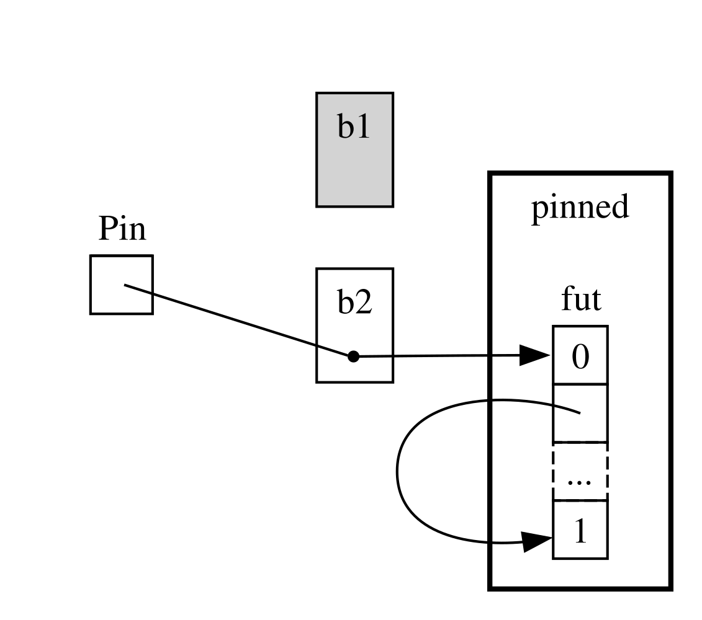
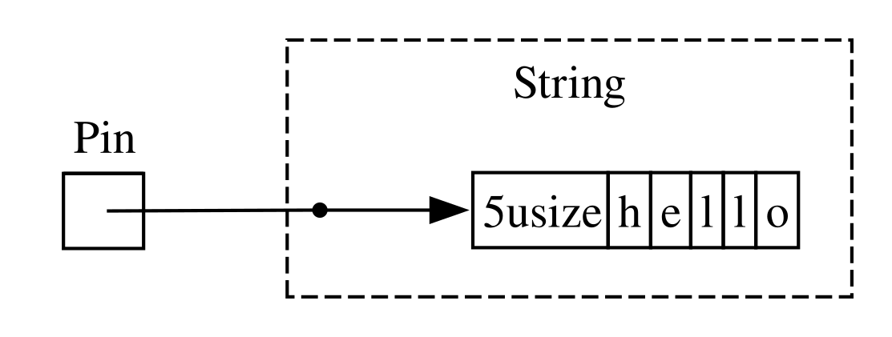
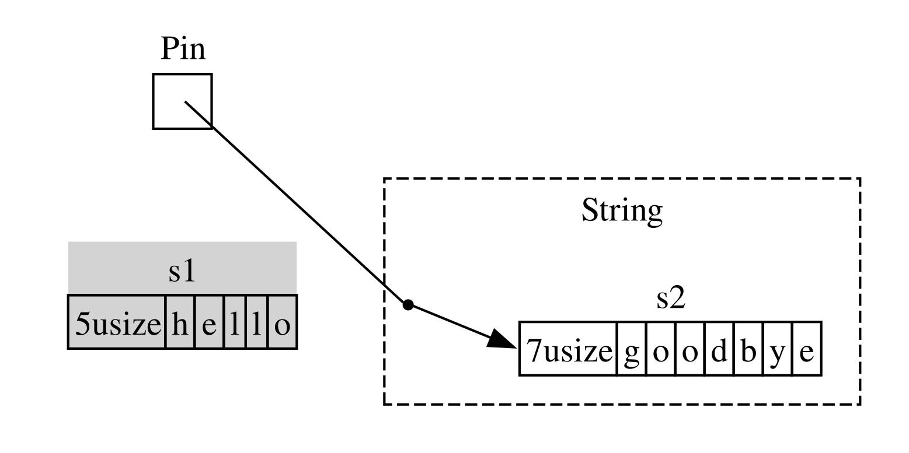

<!-- Old headings. Do not remove or links may break. -->

<a id="digging-into-the-traits-for-async"></a>

## Közelebbről az async traitjeiről {#a-closer-look-at-the-traits-for-async}

A fejezet során különféle módokon használtuk a `Future`, a `Stream` és a
`StreamExt` traitet. Eddig azonban kerültük, hogy túlságosan belemenjünk abba,
hogyan működnek, vagy hogyan illeszkednek egymáshoz, ami a mindennapi Rust
munkád során legtöbbször nem is gond. Néha azonban olyan helyzetekbe kerülsz,
ahol ezeknek a traiteknek néhány további részletét is meg kell értened, a `Pin`
típussal és az `Unpin` traittel együtt. Ebben a szakaszban épp annyira ásunk le,
amennyi ezekben a helyzetekben segít, az _igazán_ mély elmerülést továbbra is
más dokumentációkra hagyva.

<!-- Old headings. Do not remove or links may break. -->

<a id="future"></a>

### A `Future` trait {#the-future-trait}

Kezdjük azzal, hogy közelebbről megnézzük, hogyan működik a `Future` trait. A
Rust így definiálja:

```rust
use std::pin::Pin;
use std::task::{Context, Poll};

pub trait Future {
    type Output;

    fn poll(self: Pin<&mut Self>, cx: &mut Context<'_>) -> Poll<Self::Output>;
}
```

Ez a traitdefiníció egy csomó új típust és olyan szintaxist is tartalmaz,
amellyel még nem találkoztunk, ezért nézzük végig darabonként.

Először is, a `Future` `Output` társított típusa azt adja meg, hogy mire
oldódik fel a future. Ez az `Iterator` trait `Item` társított típusának
megfelelője. Másodszor, a `Future`-nek van egy `poll` metódusa, amely a `self`
paraméteréhez egy különleges `Pin` referenciát, valamint egy `Context` típusra
mutató módosítható referenciát vár, és egy `Poll<Self::Output>` értéket ad
vissza. A `Pin`-ről és a `Context`-ről hamarosan bővebben is szó lesz. Egyelőre
koncentráljunk arra, amit a metódus visszaad, a `Poll` típusra:

```rust
pub enum Poll<T> {
    Ready(T),
    Pending,
}
```

Ez a `Poll` típus hasonlít az `Option`-re. Van egy változata, amely értéket
tartalmaz, a `Ready(T)`, és egy, amely nem, a `Pending`. A `Poll` azonban
egészen mást jelent, mint az `Option`! A `Pending` változat azt jelzi, hogy a
future-nek még van dolga, így a hívónak később újra ellenőriznie kell. A `Ready`
változat azt jelzi, hogy a `Future` befejezte a munkáját, és a `T` érték
elérhető.

> Megjegyzés: Ritkán van szükség a `poll` közvetlen meghívására, de ha mégis,
> ne feledd, hogy a legtöbb future esetében a hívó nem hívhatja meg újra a
> `poll`-t, miután a future `Ready`-t adott vissza. Sok future pánikol, ha a
> készenlét után újra lekérdezik. Azok a future-ök, amelyeket biztonságos újra
> lekérdezni, ezt kifejezetten jelzik a dokumentációjukban. Ez hasonló ahhoz,
> ahogyan az `Iterator::next` viselkedik.

Ha olyan kódot látsz, amely az `await`-et használja, a Rust azt a háttérben
olyan kóddá fordítja le, amely a `poll`-t hívja. Ha visszanézel a 17-4.
kódrészletre, ahol egyetlen URL oldalcímét írtuk ki, miután feloldódott, a
Rust azt nagyjából (bár nem pontosan) ilyesmivé fordítja le:

```rust,ignore
match page_title(url).poll() {
    Ready(page_title) => match page_title {
        Some(title) => println!("The title for {url} was {title}"),
        None => println!("{url} had no title"),
    }
    Pending => {
        // But what goes here?
    }
}
```

Mit tegyünk, ha a future még mindig `Pending`? Valamilyen módon újra és újra
meg kell próbálnunk, amíg a future végre készen nem áll. Más szóval egy
ciklusra van szükségünk:

```rust,ignore
let mut page_title_fut = page_title(url);
loop {
    match page_title_fut.poll() {
        Ready(value) => match page_title {
            Some(title) => println!("The title for {url} was {title}"),
            None => println!("{url} had no title"),
        }
        Pending => {
            // continue
        }
    }
}
```

Ha azonban a Rust pontosan ilyen kóddá fordítaná, minden `await` blokkoló
lenne – pontosan az ellenkezője annak, amit szerettünk volna! Ehelyett a Rust
gondoskodik arról, hogy a ciklus átadhassa a vezérlést valaminek, ami
szüneteltetheti ennek a future-nek a feldolgozását, hogy más future-ökön
dolgozzon, majd később újra ellenőrizze ezt. Ahogy láttuk, ez a valami egy
aszinkron futtatókörnyezet, és ez az ütemezési és koordinációs munka az egyik
fő feladata.

Az [„Adatküldés két task között
üzenetküldéssel”][message-passing]<!-- ignore --> című részben leírtuk, hogyan
várunk az `rx.recv`-re. A `recv` hívás egy future-t ad vissza, és a future
bevárása lekérdezi azt. Megjegyeztük, hogy a futtatókörnyezet szünetelteti a
future-t, amíg az készen nem áll, vagy `Some(message)` értékkel, vagy – ha a
csatorna bezárul – `None` értékkel. Most, hogy mélyebben értjük a `Future`
traitet, és különösen a `Future::poll`-t, láthatjuk, hogyan működik ez. A
futtatókörnyezet tudja, hogy a future nem áll készen, ha az `Poll::Pending`-et
ad vissza. Fordítva, a futtatókörnyezet tudja, hogy a future _készen áll_, és
továbbviszi, ha a `poll` `Poll::Ready(Some(message))`-et vagy
`Poll::Ready(None)`-t ad vissza.

Az, hogy egy futtatókörnyezet pontosan hogyan csinálja ezt, túlmutat ennek a
könyvnek a keretein, de a lényeg az, hogy lásd a future-ök alapvető
működését: a futtatókörnyezet _lekérdez (polls)_ minden future-t, amelyért
felelős, és visszaaltatja a future-t, ha az még nem áll készen.

<!-- Old headings. Do not remove or links may break. -->

<a id="pinning-and-the-pin-and-unpin-traits"></a>
<a id="the-pin-and-unpin-traits"></a>

### A `Pin` típus és az `Unpin` trait {#the-pin-type-and-the-unpin-trait}

A 17-13. kódrészletben a `trpl::join!` makróval három future-t vártunk be.
Gyakori azonban, hogy van egy gyűjteményünk, például egy vektor, amely olyan
számú future-t tartalmaz, amely csak futásidőben derül ki. Alakítsuk át a
17-13. kódrészletet a 17-23. kódrészlet kódjává, amely a három future-t egy
vektorba teszi, és helyette a `trpl::join_all` függvényt hívja meg – ez még nem
fordul le.

<Listing number="17-23" caption="Egy gyűjteményben lévő future-ök bevárása"  file-name="src/main.rs">

```rust,ignore,does_not_compile
{{#rustdoc_include ../listings/ch17-async-await/listing-17-23/src/main.rs:here}}
```

</Listing>

Minden future-t egy `Box`-ba teszünk, hogy _trait objektumokká (trait
objects)_ alakítsuk őket, ugyanúgy, ahogy a 12. fejezet „Hibák visszaadása a
`run` függvényből” című részében tettük. (A trait objektumokat részletesen a 18.
fejezetben tárgyaljuk.) A trait objektumok használatával az ezek által a
típusok által előállított névtelen future-ök mindegyikét ugyanolyan típusként
kezelhetjük, mert mindegyikük megvalósítja a `Future` traitet.

Ez meglepő lehet. Végül is egyik async blokk sem ad vissza semmit, így
mindegyik egy `Future<Output = ()>` értéket állít elő. Ne feledd azonban, hogy a
`Future` egy trait, és hogy a fordító minden async blokkhoz egy egyedi enumot
hoz létre, még akkor is, ha a kimeneti típusuk azonos. Ahogy két különböző,
kézzel írt struktúrát sem tehetsz egy `Vec`-be, úgy a fordító által generált
enumokat sem keverheted.

Ezután átadjuk a future-ök gyűjteményét a `trpl::join_all` függvénynek, és
bevárjuk az eredményt. Ez azonban nem fordul le; íme a hibaüzenetek lényeges
része.

<!-- manual-regeneration
cd listings/ch17-async-await/listing-17-23
cargo build
copy *only* the final `error` block from the errors
-->

```text
error[E0277]: `dyn Future<Output = ()>` cannot be unpinned
  --> src/main.rs:48:33
   |
48 |         trpl::join_all(futures).await;
   |                                 ^^^^^ the trait `Unpin` is not implemented for `dyn Future<Output = ()>`
   |
   = note: consider using the `pin!` macro
           consider using `Box::pin` if you need to access the pinned value outside of the current scope
   = note: required for `Box<dyn Future<Output = ()>>` to implement `Future`
note: required by a bound in `futures_util::future::join_all::JoinAll`
  --> file:///home/.cargo/registry/src/index.crates.io-1949cf8c6b5b557f/futures-util-0.3.30/src/future/join_all.rs:29:8
   |
27 | pub struct JoinAll<F>
   |            ------- required by a bound in this struct
28 | where
29 |     F: Future,
   |        ^^^^^^ required by this bound in `JoinAll`
```

A hibaüzenetben lévő megjegyzés azt mondja, hogy a `pin!` makróval _rögzítsük
(pin)_ az értékeket, ami azt jelenti, hogy a `Pin` típusba tesszük őket, amely
garantálja, hogy az értékek nem mozdulnak el a memóriában. A hibaüzenet szerint
a rögzítésre azért van szükség, mert a `dyn Future<Output = ()>`-nak meg kell
valósítania az `Unpin` traitet, de jelenleg nem valósítja meg.

A `trpl::join_all` függvény egy `JoinAll` nevű struktúrát ad vissza. Ez a
struktúra generikus egy `F` típus felett, amelyre az a megkötés vonatkozik,
hogy meg kell valósítania a `Future` traitet. Egy future közvetlen bevárása az
`await`-tel implicit módon rögzíti a future-t. Ezért nem kell mindenhol a
`pin!`-t használnunk, ahol future-öket szeretnénk bevárni.

Itt azonban nem közvetlenül várunk be egy future-t. Ehelyett egy új future-t,
a JoinAll-t hozzuk létre úgy, hogy future-ök gyűjteményét adjuk át a
`join_all` függvénynek. A `join_all` szignatúrája megköveteli, hogy a
gyűjtemény elemeinek típusai mind megvalósítsák a `Future` traitet, a `Box<T>`
pedig csak akkor valósítja meg a `Future`-t, ha az általa burkolt `T` egy olyan
future, amely megvalósítja az `Unpin` traitet.

Ez rengeteg információ egyszerre! Hogy igazán megértsük, merüljünk el egy
kicsit jobban abban, hogyan működik valójában a `Future` trait, különösen a
rögzítés tekintetében. Nézd meg újra a `Future` trait definícióját:

```rust
use std::pin::Pin;
use std::task::{Context, Poll};

pub trait Future {
    type Output;

    // Required method
    fn poll(self: Pin<&mut Self>, cx: &mut Context<'_>) -> Poll<Self::Output>;
}
```

A `cx` paraméter és annak `Context` típusa a kulcsa annak, hogy egy
futtatókörnyezet ténylegesen honnan tudja, mikor kell egy adott future-t
ellenőriznie, miközben lusta marad. A működés részletei itt is túlmutatnak
ennek a fejezetnek a keretein, és ezen általában csak akkor kell
elgondolkodnod, ha saját `Future`-megvalósítást írsz. Ehelyett a `self`
típusára koncentrálunk, mivel most látunk először olyan metódust, ahol a
`self` típusannotációval rendelkezik. A `self` típusannotációja ugyanúgy
működik, mint a többi függvényparaméter típusannotációja, két fontos
különbséggel:

- Megmondja a Rustnak, milyen típusúnak kell lennie a `self`-nek ahhoz, hogy a
  metódus meghívható legyen.
- Nem lehet akármilyen típus. Csak az a típus lehet, amelyen a metódus meg van
  valósítva, egy erre a típusra mutató referencia vagy okos mutató, vagy egy
  erre a típusra mutató referenciát burkoló `Pin`.

Erről a szintaxisról a [18. fejezetben][ch-18]<!-- ignore --> többet is
látunk. Egyelőre elég annyit tudni, hogy ha le akarunk kérdezni egy future-t,
hogy ellenőrizzük, `Pending` vagy `Ready(Output)` állapotban van-e, akkor a
típusra mutató, `Pin`-be burkolt módosítható referenciára van szükségünk.

A `Pin` a mutatószerű típusok – például a `&`, a `&mut`, a `Box` és az `Rc` –
burkolója. (Technikailag a `Pin` a `Deref` vagy `DerefMut` traitet megvalósító
típusokkal működik, de ez gyakorlatilag egyenértékű azzal, hogy csak
referenciákkal és okos mutatókkal működik.) A `Pin` maga nem mutató, és nincs
saját viselkedése, ahogy az `Rc`-nek és az `Arc`-nak a referenciaszámlálás;
pusztán egy eszköz, amellyel a fordító megkötéseket kényszeríthet ki a
mutatók használatára.

Ha felidézzük, hogy az `await` a `poll` hívásaival van megvalósítva, az kezdi
megmagyarázni a korábban látott hibaüzenetet, de az az `Unpin`-ről szólt, nem a
`Pin`-ről. Pontosan hogyan kapcsolódik tehát a `Pin` az `Unpin`-hez, és miért
van szüksége a `Future`-nek arra, hogy a `self` `Pin` típusban legyen a `poll`
meghívásához?

Emlékezz vissza a fejezet korábbi részéből, hogy egy future-ben lévő
await-pontok sorozata állapotgéppé fordul le, és a fordító gondoskodik arról,
hogy ez az állapotgép betartsa a Rust összes szokásos biztonsági szabályát,
beleértve a kölcsönzést és a tulajdonjogot. Ahhoz, hogy ez működjön, a Rust
megvizsgálja, milyen adatokra van szükség az egyik await-pont és a következő
await-pont, illetve az async blokk vége között. Ezután létrehoz egy megfelelő
változatot a lefordított állapotgépben. Minden változat megkapja a szükséges
hozzáférést azokhoz az adatokhoz, amelyeket a forráskód adott szakasza
használni fog, akár úgy, hogy átveszi az adatok tulajdonjogát, akár úgy, hogy
módosítható vagy nem módosítható referenciát kap rájuk.

Eddig rendben is vagyunk: ha egy adott async blokkban bármit elrontunk a
tulajdonjoggal vagy a referenciákkal kapcsolatban, a kölcsönzésellenőrző szólni
fog. Amikor azonban az adott blokknak megfelelő future-t szeretnénk mozgatni –
például egy `Vec`-be tenni, hogy átadjuk a `join_all`-nak –, a dolgok
bonyolultabbá válnak.

Amikor egy future-t mozgatunk – akár úgy, hogy egy adatszerkezetbe tesszük, hogy
iterátorként használjuk a `join_all`-lal, akár úgy, hogy visszaadjuk egy
függvényből –, az valójában a Rust által nekünk létrehozott állapotgép
mozgatását jelenti. És a Rust legtöbb más típusával ellentétben a Rust által az
async blokkokhoz létrehozott future-ök bármelyik változatuk mezőiben
tartalmazhatnak önmagukra mutató referenciákat, ahogy a 17-4. ábra
egyszerűsített illusztrációja mutatja.

<figure>



<figcaption>17-4. ábra: Önhivatkozó adattípus</figcaption>

</figure>

Alapértelmezés szerint azonban minden olyan objektumot, amely önmagára mutató
referenciát tartalmaz, nem biztonságos mozgatni, mert a referenciák mindig
annak a tényleges memóriacímére mutatnak, amire hivatkoznak (lásd a 17-5.
ábrát). Ha magát az adatszerkezetet mozgatod, ezek a belső referenciák továbbra
is a régi helyre fognak mutatni. Ez a memóriahely azonban most már érvénytelen.
Egyrészt az értéke nem frissül, amikor módosítod az adatszerkezetet. Másrészt –
és ez a fontosabb – a számítógép most már szabadon újrahasznosíthatja ezt a
memóriát más célokra! Később akár teljesen független adatokat is olvashatsz
onnan.

<figure>


<figcaption>17-5. ábra: Egy önhivatkozó adattípus mozgatásának nem biztonságos eredménye</figcaption>

</figure>

Elméletben a Rust fordító megpróbálhatná frissíteni egy objektumra mutató
összes referenciát, valahányszor az objektumot mozgatják, de ez jelentős
teljesítménybeli többletterheléssel járhatna, különösen ha referenciák egész
hálózatát kellene frissíteni. Ha ehelyett biztosítani tudnánk, hogy a kérdéses
adatszerkezet _ne mozduljon el a memóriában_, egyetlen referenciát sem
kellene frissítenünk. Pontosan erre való a Rust kölcsönzésellenőrzője:
biztonságos kódban megakadályozza, hogy bármilyen olyan elemet mozgass,
amelyre aktív referencia mutat.

A `Pin` erre építve pontosan azt a garanciát adja, amelyre szükségünk van.
Amikor egy értéket úgy _rögzítünk_, hogy az arra mutató mutatót `Pin`-be
burkoljuk, az érték többé nem mozdulhat el. Ha tehát van egy
`Pin<Box<SomeType>>` értéked, akkor valójában a `SomeType` értéket rögzíted,
_nem_ a `Box` mutatót. A 17-6. ábra ezt a folyamatot szemlélteti.

<figure>


<figcaption>17-6. ábra: Egy önhivatkozó future típusra mutató `Box` rögzítése</figcaption>

</figure>

Valójában a `Box` mutató továbbra is szabadon mozoghat. Ne feledd: arról
akarunk gondoskodni, hogy a végső soron hivatkozott adat a helyén maradjon. Ha
egy mutató elmozdul, _de az adat, amelyre mutat,_ ugyanott marad, ahogy a 17-7.
ábrán, akkor nincs semmilyen lehetséges probléma. (Önálló gyakorlásként nézd
meg a típusok, valamint az `std::pin` modul dokumentációját, és próbáld meg
kitalálni, hogyan csinálnád ezt egy `Box`-ot burkoló `Pin`-nel.) A lényeg az,
hogy maga az önhivatkozó típus nem mozdulhat el, mert továbbra is rögzítve van.

<figure>



<figcaption>17-7. ábra: Egy önhivatkozó future típusra mutató `Box` mozgatása</figcaption>

</figure>

A legtöbb típust azonban teljesen biztonságos mozgatni, még akkor is, ha
történetesen egy `Pin` mutató mögött vannak. A rögzítésen csak akkor kell
gondolkodnunk, ha az elemeknek vannak belső referenciái. Az olyan primitív
értékek, mint a számok és a logikai értékek, biztonságosak, mert nyilvánvalóan
nincsenek belső referenciáik. És a legtöbb típusnak sincs, amellyel a Rustban
általában dolgozol. Egy `Vec`-et például gond nélkül mozgathatsz. Az eddig
látottak alapján, ha van egy `Pin<Vec<String>>` értéked, mindent a `Pin` által
biztosított biztonságos, de korlátozó API-kon keresztül kellene csinálnod,
pedig egy `Vec<String>` mozgatása mindig biztonságos, ha nem mutat rá más
referencia. Szükségünk van egy módra, amellyel jelezhetjük a fordítónak, hogy
az ilyen esetekben nyugodtan mozgathatók az elemek – és itt jön képbe az
`Unpin`.

Az `Unpin` egy jelölő trait (marker trait), hasonlóan a 16. fejezetben látott
`Send` és `Sync` traithez, így nincs saját funkcionalitása. A jelölő traitek
csak arra szolgálnak, hogy jelezzék a fordítónak: az adott traitet megvalósító
típus biztonságosan használható egy bizonyos kontextusban. Az `Unpin` azt
közli a fordítóval, hogy az adott típusnak _nem_ kell semmilyen garanciát
fenntartania arra vonatkozóan, hogy a kérdéses érték biztonságosan
mozgatható-e.

<!--
  The inline `<code>` in the next block is to allow the inline `<em>` inside it,
  matching what NoStarch does style-wise, and emphasizing within the text here
  that it is something distinct from a normal type.
-->

Ahogy a `Send` és a `Sync` esetében, a fordító az `Unpin`-t is automatikusan
megvalósítja minden olyan típusra, amelyről be tudja bizonyítani, hogy
biztonságos. Különleges eset – szintén a `Send`-hez és a `Sync`-hez hasonlóan –,
amikor az `Unpin` _nincs_ megvalósítva egy típusra. Ennek jelölése
<code>impl !Unpin for <em>SomeType</em></code>, ahol a
<code><em>SomeType</em></code> egy olyan típus neve, amelynek _fenn kell_
tartania ezeket a garanciákat ahhoz, hogy biztonságos legyen, valahányszor egy
rá mutató mutatót egy `Pin`-ben használnak.

Más szóval a `Pin` és az `Unpin` kapcsolatával kapcsolatban két dolgot kell
szem előtt tartani. Először is, az `Unpin` a „normál” eset, a `!Unpin` pedig a
különleges eset. Másodszor, az, hogy egy típus az `Unpin`-t vagy a `!Unpin`-t
valósítja-e meg, _csak_ akkor számít, ha egy erre a típusra mutató rögzített
mutatót használsz, például <code>Pin<&mut <em>SomeType</em>></code>.

Hogy ezt konkrétabbá tegyük, gondoljunk egy `String`-re: van egy hossza, és
azok a Unicode-karakterek, amelyekből áll. Egy `String`-et becsomagolhatunk
`Pin`-be, ahogy a 17-8. ábrán látható. A `String` azonban automatikusan
megvalósítja az `Unpin`-t, ahogy a Rust legtöbb más típusa is.

<figure>



<figcaption>17-8. ábra: Egy `String` rögzítése; a pontozott vonal azt jelzi, hogy a `String` megvalósítja az `Unpin` traitet, így nincs rögzítve</figcaption>

</figure>

Ennek eredményeként olyan dolgokat is megtehetünk, amelyek tiltottak lennének,
ha a `String` ehelyett a `!Unpin`-t valósítaná meg, például lecserélhetünk egy
sztringet egy másikra pontosan ugyanazon a memóriahelyen, ahogy a 17-9. ábrán.
Ez nem sérti a `Pin` szerződését, mert a `String`-nek nincsenek olyan belső
referenciái, amelyek miatt a mozgatása nem lenne biztonságos. Pontosan ezért
valósítja meg az `Unpin`-t a `!Unpin` helyett.

<figure>



<figcaption>17-9. ábra: A `String` lecserélése egy teljesen más `String`-re a memóriában</figcaption>

</figure>

Most már eleget tudunk ahhoz, hogy megértsük a 17-23. kódrészletben lévő
`join_all` hívásra jelentett hibákat. Eredetileg az async blokkok által
előállított future-öket próbáltuk egy `Vec<Box<dyn Future<Output = ()>>>`
vektorba mozgatni, de ahogy láttuk, ezeknek a future-öknek lehetnek belső
referenciáik, így nem valósítják meg automatikusan az `Unpin`-t. Miután
rögzítjük őket, az így kapott `Pin` típust átadhatjuk a `Vec`-nek, abban a
biztos tudatban, hogy a future-ökben lévő mögöttes adatok _nem_ mozdulnak el.
A 17-24. kódrészlet bemutatja, hogyan javíthatjuk a kódot úgy, hogy a három
future definiálásának helyén meghívjuk a `pin!` makrót, és módosítjuk a trait
objektum típusát.

<Listing number="17-24" caption="A future-ök rögzítése, hogy a vektorba mozgathassuk őket">

```rust
{{#rustdoc_include ../listings/ch17-async-await/listing-17-24/src/main.rs:here}}
```

</Listing>

Ez a példa most már lefordul és lefut, és futásidőben future-öket adhatnánk
hozzá a vektorhoz vagy távolíthatnánk el belőle, majd mindegyiket
összekapcsolhatnánk.

A `Pin` és az `Unpin` főleg alacsonyabb szintű könyvtárak készítésénél, vagy
magának a futtatókörnyezetnek a megírásakor fontos, nem pedig a mindennapi
Rust kódban. Ha azonban ezekkel a traitekkel találkozol a hibaüzenetekben, most
már jobban fogod tudni, hogyan javítsd a kódodat!

> Megjegyzés: A `Pin` és az `Unpin` ilyen kombinációja lehetővé teszi, hogy a
> Rustban biztonságosan megvalósítsuk az összetett típusok egy egész osztályát,
> amely egyébként nehézségeket okozna, mert önhivatkozók. A `Pin`-t igénylő
> típusok ma leggyakrabban az async Rustban fordulnak elő, de időnként más
> kontextusokban is találkozhatsz velük.
>
> Az `std::pin` API-dokumentációja részletesen tárgyalja, hogyan működik
> pontosan a `Pin` és az `Unpin`, és milyen szabályokat kell betartaniuk, így ha
> többet szeretnél megtudni, ez remek kiindulópont.
>
> Ha még részletesebben meg szeretnéd érteni, hogyan működnek a dolgok a
> háttérben, lásd az [_Asynchronous Programming in Rust_][async-book] című könyv
> [2.][under-the-hood]<!-- ignore --> és
> [4.][pinning]<!-- ignore --> fejezetét.

### A `Stream` trait {#the-stream-trait}

Most, hogy mélyebben érted a `Future`, a `Pin` és az `Unpin` traitet, a
`Stream` traitre fordíthatjuk a figyelmünket. Ahogy a fejezet korábbi részében
megtanultad, a streamek az aszinkron iterátorokhoz hasonlítanak. Az
`Iterator`-ral és a `Future`-rel ellentétben azonban a `Stream`-nek e sorok
írásakor nincs definíciója a standard könyvtárban, de _van_ egy nagyon
elterjedt definíció a `futures` crate-ből, amelyet az egész ökoszisztémában
használnak.

Nézzük át az `Iterator` és a `Future` trait definícióját, mielőtt megnéznénk,
hogyan egyesítheti őket egy `Stream` trait. Az `Iterator`-tól a sorozat
gondolatát kapjuk: a `next` metódusa egy `Option<Self::Item>` értéket ad. A
`Future`-től az idővel bekövetkező készenlét gondolatát kapjuk: a `poll`
metódusa egy `Poll<Self::Output>` értéket ad. Az idővel készenlétbe kerülő
elemek sorozatának ábrázolásához definiálunk egy `Stream` traitet, amely ezeket
a jellemzőket egyesíti:

```rust
use std::pin::Pin;
use std::task::{Context, Poll};

trait Stream {
    type Item;

    fn poll_next(
        self: Pin<&mut Self>,
        cx: &mut Context<'_>
    ) -> Poll<Option<Self::Item>>;
}
```

A `Stream` trait egy `Item` nevű társított típust definiál a stream által
előállított elemek típusához. Ez az `Iterator`-hoz hasonló, ahol nullától
akárhány elem lehet, és eltér a `Future`-től, ahol mindig egyetlen `Output`
van, még ha az a `()` unit típus is.

A `Stream` egy metódust is definiál ezeknek az elemeknek a lekéréséhez. Ennek
`poll_next` a neve, hogy egyértelmű legyen: ugyanúgy lekérdez, ahogy a
`Future::poll`, és ugyanúgy elemek sorozatát állítja elő, ahogy az
`Iterator::next`. A visszatérési típusa a `Poll`-t kombinálja az `Option`-nel.
A külső típus a `Poll`, mert a készenlétét ellenőrizni kell, akárcsak egy
future-ét. A belső típus az `Option`, mert jeleznie kell, hogy vannak-e még
üzenetek, akárcsak egy iterátornak.

Valószínűleg valami nagyon hasonló definíció végül a Rust standard
könyvtárának része lesz. Addig is a legtöbb futtatókörnyezet eszközkészletének
része, így támaszkodhatsz rá, és mindaz, amiről a következőkben szó lesz,
általában érvényes lesz!

A [„Streamek: future-ök sorozatban”][streams]<!-- ignore --> című részben
látott példákban azonban sem a `poll_next`-et, _sem_ a `Stream`-et nem
használtuk, hanem a `next`-et és a `StreamExt`-et. Természetesen
dolgozhatnánk közvetlenül a `poll_next` API-val is, ha kézzel írnánk meg a
saját `Stream` állapotgépeinket, ahogy a future-ökkel is dolgozhatnánk
közvetlenül a `poll` metódusukon keresztül. Az `await` használata azonban sokkal
kényelmesebb, és a `StreamExt` trait biztosítja a `next` metódust, hogy
pontosan ezt tehessük:

```rust
{{#rustdoc_include ../listings/ch17-async-await/no-listing-stream-ext/src/lib.rs:here}}
```

<!--
TODO: update this if/when tokio/etc. update their MSRV and switch to using async functions
in traits, since the lack thereof is the reason they do not yet have this.
-->

> Megjegyzés: A fejezetben korábban használt tényleges definíció kissé
> eltér ettől, mert olyan Rust-verziókat is támogat, amelyek még nem
> támogatták az async függvények használatát traitekben. Ennek eredményeként
> így néz ki:
>
> ```rust,ignore
> fn next(&mut self) -> Next<'_, Self> where Self: Unpin;
> ```
>
> Ez a `Next` típus egy `struct`, amely megvalósítja a `Future`-t, és lehetővé
> teszi, hogy a `Next<'_, Self>` segítségével megnevezzük a `self`-re mutató
> referencia élettartamát, így az `await` működhet ezzel a metódussal.

A `StreamExt` trait egyben a streamekkel használható összes érdekes metódus
otthona is. A `StreamExt` automatikusan meg van valósítva minden olyan
típusra, amely megvalósítja a `Stream`-et, de ezeket a traiteket külön
definiálják, hogy a közösség az alapul szolgáló trait befolyásolása nélkül
fejleszthesse a kényelmi API-kat.

A `trpl` crate-ben használt `StreamExt` változatban a trait nemcsak definiálja
a `next` metódust, hanem a `next`-nek egy olyan alapértelmezett megvalósítását
is biztosítja, amely helyesen kezeli a `Stream::poll_next` hívásának
részleteit. Ez azt jelenti, hogy még ha saját streamelő adattípust kell is
írnod, _csak_ a `Stream`-et kell megvalósítanod, és utána bárki, aki a te
adattípusodat használja, automatikusan használhatja vele a `StreamExt`-et és
annak metódusait.

Ennyit tárgyalunk ezeknek a traiteknek az alacsonyabb szintű részleteiből.
Befejezésül nézzük meg, hogyan illeszkednek egymáshoz a future-ök (beleértve
a streameket is), a taskok és a szálak!

[message-passing]: ch17-02-concurrency-with-async.md#sending-data-between-two-tasks-using-message-passing
[ch-18]: ch18-00-oop.html
[async-book]: https://rust-lang.github.io/async-book/
[under-the-hood]: https://rust-lang.github.io/async-book/02_execution/01_chapter.html
[pinning]: https://rust-lang.github.io/async-book/04_pinning/01_chapter.html
[first-async]: ch17-01-futures-and-syntax.html#our-first-async-program
[any-number-futures]: ch17-03-more-futures.html#working-with-any-number-of-futures
[streams]: ch17-04-streams.html
