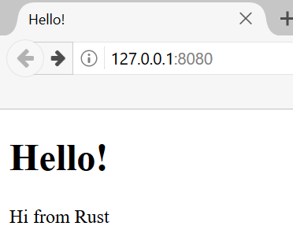

# Záróprojekt: többszálú webszerver készítése {#final-project-building-a-multithreaded-web-server}

Hosszú út áll mögöttünk, de elértünk a könyv végére. Ebben a fejezetben még
egy projektet építünk fel együtt, hogy bemutassunk néhányat az utolsó
fejezetekben tárgyalt fogalmak közül, és átismételjünk néhány korábbi
tanulságot is.

Záróprojektként egy olyan webszervert készítünk, amely „Hello!”-val köszön,
és a webböngészőben a 21-1. ábrán láthatóhoz hasonlóan néz ki.

A webszerver elkészítésének terve a következő:

1. Megismerkedünk egy kicsit a TCP-vel és a HTTP-vel.
2. TCP-kapcsolatokat figyelünk egy socketen.
3. Feldolgozunk néhány egyszerű HTTP-kérést.
4. Szabályos HTTP-választ állítunk elő.
5. Szálkészlettel (thread pool) javítjuk a szerverünk áteresztőképességét.

21-1. ábra: Közös záróprojektünk

Mielőtt belekezdünk, két részletet érdemes megemlítenünk. Először is: az a
módszer, amelyet használni fogunk, nem a legjobb módja annak, hogy Rustban
webszervert készítsünk. A közösség tagjai számos éles használatra kész
crate-et tettek közzé a [crates.io](https://crates.io/) oldalon, amelyek
teljesebb webszerver- és szálkészlet-megvalósítást kínálnak annál, amit mi
készítünk. Ebben a fejezetben azonban az a célunk, hogy segítsünk a
tanulásban, nem az, hogy a könnyebb utat válasszuk. Mivel a Rust
rendszerprogramozási nyelv, megválaszthatjuk, milyen absztrakciós szinten
szeretnénk dolgozni, és alacsonyabb szintre is leereszkedhetünk, mint ami más
nyelvekben lehetséges vagy célszerű.

Másodszor: itt nem fogjuk használni az async és await kulcsszavakat. Egy
szálkészlet elkészítése önmagában is elég nagy kihívás, nem kell még egy
async futtatókörnyezet megírását is hozzávennünk! Azért jelezni fogjuk, hogyan
lehetne az async és az await hasznos néhány olyan problémánál, amellyel ebben
a fejezetben találkozunk. Végső soron, ahogy a 17. fejezetben is említettük,
sok async futtatókörnyezet szálkészletet használ a munkája kezelésére.

Ezért az alapvető HTTP-szervert és a szálkészletet kézzel írjuk meg, hogy
megismerd azokat az általános ötleteket és technikákat, amelyek a jövőben
esetleg használt crate-ek mögött állnak.
